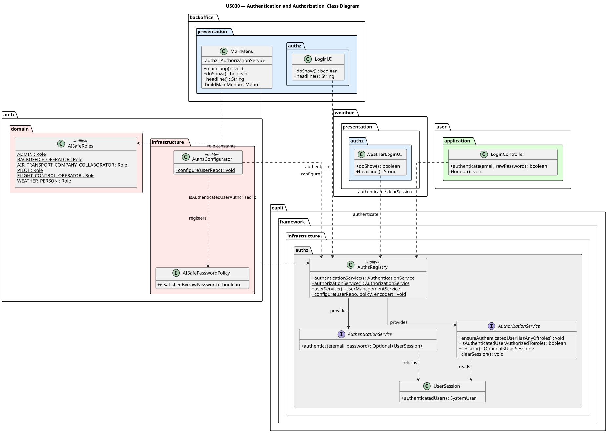
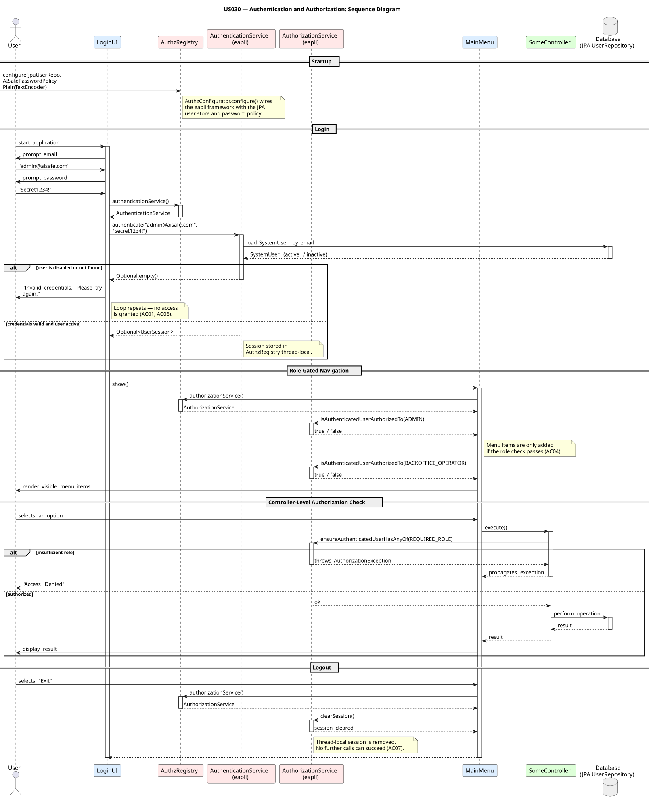

# US030 — Authentication and Authorization

## User Story

> As a **Project Manager**, I want the system to support and apply authentication and authorization for all its users and functionalities.
> The team is advised to use existing frameworks to handle authentication and user management. These are a necessity but are not the main business focus of the system.

---

## Acceptance Criteria

| # | Criterion |
|---|-----------|
| AC01 | An unauthenticated user cannot access any functionality of the system. |
| AC02 | The system authenticates users via a unique email and password. |
| AC03 | Each user has an assigned role (Admin, Backoffice Operator, ATCC, Pilot, FCO, Weather Person). |
| AC04 | Each functionality/endpoint is only accessible to the role(s) with the appropriate permission. |
| AC05 | Authentication and authorization also apply to remote access via TCP (US044, US078, US086). |
| AC06 | A disabled user cannot authenticate into the system. |
| AC07 | The session expires or is invalidated after logout. |

---

## Implementation Overview

| Module | Role |
|--------|------|
| `aisafe.infrastructure.application` | Auth framework wiring (`AuthzConfigurator`, `AISafeRoles`, `AISafePasswordPolicy`) |
| `aisafe.core` | Application controller (`LoginController`) |
| `aisafe.app.backoffice.console` | Backoffice login UI (`LoginUI`) and role-gated main menu (`MainMenu`) |
| `aisafe.app.airtransport.console` | Air Transport login UI (same pattern; gates ATCC and Pilot features) |
| `aisafe.app.weather.client` | Weather TCP client login UI (`WeatherLoginUI`; gates Weather Person features) |

---

## Class Diagram



---

## Sequence Diagram — Login and Role-Gated Access (Console)



---

## Authentication Flow

All application entry points follow the same pattern:

1. `AuthzConfigurator.configure(userRepository)` is called once at startup to wire the eapli auth framework with the JPA user store and the `AISafePasswordPolicy`.
2. A `LoginUI` prompts for **email** and **password**.
3. Credentials are passed to `AuthzRegistry.authenticationService().authenticate(email, password)`.
   - Returns an `Optional<UserSession>` — empty if credentials are wrong or the user is **disabled** (AC06).
   - The loop repeats until authentication succeeds.
4. On success, the framework stores the session in the `AuthzRegistry` thread-local context.
5. Every subsequent controller call to `authz.ensureAuthenticatedUserHasAnyOf(...)` reads from that session (AC01, AC04).
6. On logout, `AuthzRegistry.authorizationService().clearSession()` removes the session (AC07).

---

## Authorization Flow

Authorization is enforced in every application controller at the point of business logic, not only at the UI level:

```
Controller.someOperation() {
    authz.ensureAuthenticatedUserHasAnyOf(AISafeRoles.REQUIRED_ROLE);
    // ... business logic
}
```

The `MainMenu` additionally performs a role check before rendering each menu item, so users only see options they are permitted to use:

```java
if (authz.isAuthenticatedUserAuthorizedTo(AISafeRoles.ADMIN)) {
    mainMenu.addItem(USERS_OPTION, "Users Management", ...);
}
if (authz.isAuthenticatedUserAuthorizedTo(AISafeRoles.BACKOFFICE_OPERATOR)) {
    mainMenu.addItem(ENGINE_MODELS_OPTION, "Engine Models", ...);
    // ... other backoffice items
}
```

---

## Roles

| Role constant | String token | Assigned to |
|---------------|-------------|-------------|
| `AISafeRoles.ADMIN` | `ADMIN` | System administrator |
| `AISafeRoles.BACKOFFICE_OPERATOR` | `BACKOFFICE_OPERATOR` | Backoffice operators |
| `AISafeRoles.AIR_TRANSPORT_COMPANY_COLLABORATOR` | `ATCC` | Air Transport Company Collaborators |
| `AISafeRoles.PILOT` | `PILOT` | Pilots |
| `AISafeRoles.FLIGHT_CONTROL_OPERATOR` | `FCO` | Flight Control Operators |
| `AISafeRoles.WEATHER_PERSON` | `WEATHER_PERSON` | Weather Persons |

---

## Password Policy

`AISafePasswordPolicy` enforces a minimum password length of **8 characters**. The policy is registered at startup via `AuthzConfigurator` and is applied whenever a new user is registered or a password is changed.

---

## Remote Access (TCP — AC05)

Remote access applications (Weather Client — US044, Air Transport App — US078/US086) authenticate the same way as the console applications. The `WeatherLoginUI` calls `AuthzRegistry.authenticationService()` before any TCP communication takes place. Any request sent over TCP carries the identity of the authenticated session; the server-side handler re-validates the role before processing the command.

---

## Key Classes

| Class | Location | Responsibility |
|-------|----------|----------------|
| `LoginController` | `user.application` | Thin controller wrapping `AuthzRegistry.authenticationService()` and `clearSession()` |
| `LoginUI` | `backoffice.presentation.authz` | Prompts for email/password; loops until authentication succeeds |
| `WeatherLoginUI` | `weather.presentation.authz` | Same pattern for the Weather TCP client application |
| `MainMenu` | `backoffice.presentation` | Builds role-gated menu — only items the authenticated user is authorized for are shown |
| `AuthzConfigurator` | `auth.infrastructure` | Wires `AuthzRegistry` with `JpaAutoTxUserRepository` and `AISafePasswordPolicy` at startup |
| `AISafeRoles` | `auth.domain` | Declares all system role constants used by every controller for authorization checks |
| `AISafePasswordPolicy` | `auth.infrastructure` | Enforces minimum 8-character password rule |
