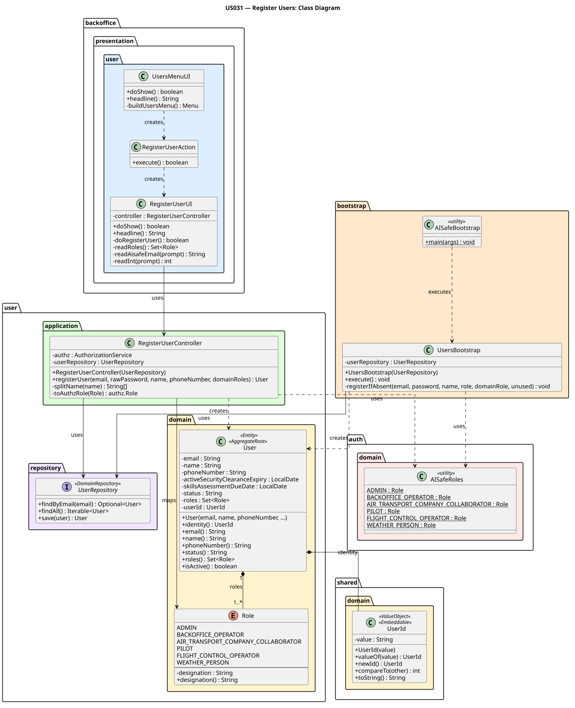
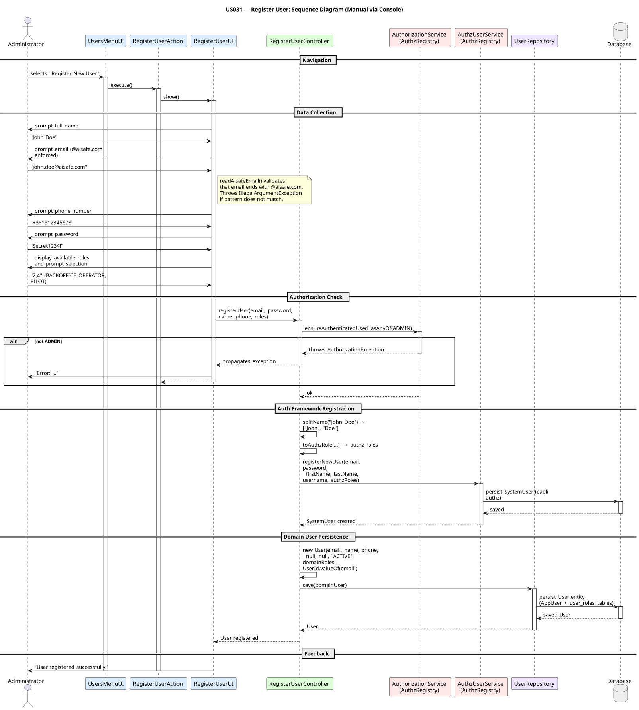

# US031 — Register Users

## User Story

> As an **Administrator**, I want to be able to register users of the backoffice.
> This must also be achieved by a bootstrap process.

---

## Acceptance Criteria

| # | Criterion |
|---|-----------|
| AC1 | Only an authenticated **Admin** may register new users. |
| AC2 | Email must end with `@aisafe.com`. |
| AC3 | At least one role must be assigned to the new user. |
| AC4 | The user is persisted in both the auth framework (`SystemUser`) and the domain model (`User`). |
| AC5 | The bootstrap process registers seed users if they do not already exist (idempotent). |

---

## Implementation Overview

| Module | Role |
|--------|------|
| `aisafe.app.backoffice.console` | Interactive console UI (`RegisterUserUI`, `RegisterUserAction`) |
| `aisafe.core` | Application controller (`RegisterUserController`) and domain model (`User`, `Role`) |
| `aisafe.app.bootstrap` | Seed data (`UsersBootstrap`, `AISafeBootstrap`) |

---

## Class Diagram

---

## Sequence Diagram — Manual Registration (Console)

---

## User Interaction Flow

1. Administrator logs in and navigates to **Register New User** from the Users menu.
2. The console prompts for:
   - Full name (e.g. `John Doe`)
   - Email address — must end with `@aisafe.com`
   - Phone number (e.g. `+351912345678`)
   - Password
   - One or more roles selected from the available list
3. `RegisterUserController` verifies the caller has the `ADMIN` role via `AuthorizationService`.
4. The user is registered in the eapli auth framework (`AuthzRegistry.userService().registerNewUser(…)`).
5. A domain `User` entity is created and saved via `UserRepository`.
6. The console prints `User registered successfully.`

---

## Bootstrap Process

`AISafeBootstrap.main()` is the application entry point for loading seed data. It instantiates `UsersBootstrap` and calls `execute()`, which registers the following seed users if they do not already exist:

| Email | Role |
|-------|------|
| `admin@aisafe.com` | ADMIN |
| `bo@aisafe.com` | BACKOFFICE_OPERATOR |
| `pilot@aisafe.com` | PILOT |
| `fco@aisafe.com` | FLIGHT_CONTROL_OPERATOR |
| `weather@aisafe.com` | WEATHER_PERSON |

Each seed user is registered in the auth framework and persisted as a domain `User`. The process is **idempotent** — re-running bootstrap does not create duplicates.

---

## Key Classes

| Class | Location | Responsibility |
|-------|----------|----------------|
| `RegisterUserUI` | `backoffice.presentation.user` | Console form — collects input, validates email format, delegates to controller |
| `RegisterUserAction` | `backoffice.presentation.user` | Menu action wiring — instantiates and shows `RegisterUserUI` |
| `RegisterUserController` | `user.application` | Enforces ADMIN authorization, registers user in auth framework and domain |
| `User` | `user.domain` | Aggregate root — holds email, name, phone, status, and roles |
| `Role` | `user.domain` | Enum of all system roles with display designations |
| `UserId` | `shared.domain` | Value object used as the aggregate identity (keyed on email) |
| `UserRepository` | `user.repository` | Domain repository interface for persisting and querying users |
| `UsersBootstrap` | `bootstrap` | Seeds default users on first run; idempotent |
| `AISafeBootstrap` | `bootstrap` | Application bootstrap entry point — orchestrates all seed data loaders |

---

## EAPLI Theoretical Principles — Practical Application

### Domain-Driven Design (DDD)

- **Ubiquitous Language**: "User," "Email," "Role" form the core vocabulary of the user management subdomain.
- **Bounded Context**: User Management is separate from other domains, with entities (`User`), value objects (`Email`), and repositories (`UserRepository`).
- **Aggregate Root**: `User` is the aggregate root — controls access to roles and status properties.
- **Value Objects**: `Email` (must end with `@aisafe.com`), `Password`, `Role` are immutable and validated.
- **Repository Pattern**: `UserRepository` abstracts persistence, decoupling domain logic from database details.

### Gang of Four Design Patterns

| Pattern | Application | Benefit |
|---------|------------|---------|
| **Repository** | `UserRepository` provides collection-like abstraction over persistence | Decouples domain from JPA/SQL |
| **Builder** | `RegisterUserUI` builds user input step-by-step before controller execution | Encapsulates multi-step form logic |

### SOLID Principles

- **Single Responsibility Principle (SRP)**: `User` manages user state; `UserRepository` handles persistence; `RegisterUserController` orchestrates registration.
- **Open/Closed Principle (OCP)**: New role types can be added without modifying `User` class.
- **Liskov Substitution Principle (LSP)**: `UserRepository` implementations (JPA, in-memory) are interchangeable.
- **Interface Segregation Principle (ISP)**: `UserRepository` exposes only needed methods (`save()`, `findByEmail()`, `findAll()`).
- **Dependency Inversion Principle (DIP)**: `RegisterUserController` depends on `UserRepository` abstraction, not concrete implementations.
