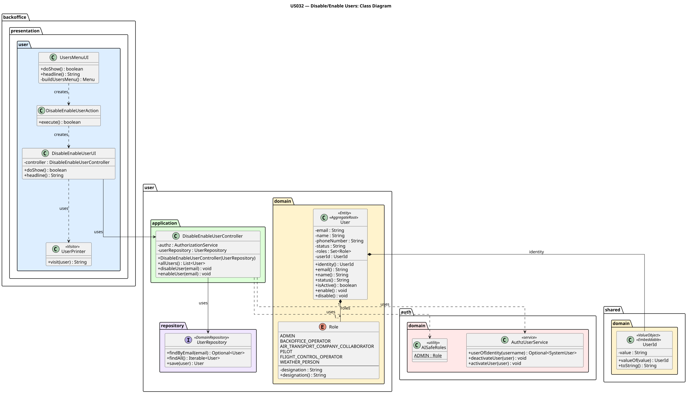

# US032 — Disable/Enable Users

## User Story

> As an **Administrator**, I want to be able to disable/enable users of the backoffice.

---

## Acceptance Criteria

| # | Criterion |
|---|-----------|
| AC1 | Only an authenticated **Admin** may disable or enable users. |
| AC2 | The administrator selects the target user from a list showing current status. |
| AC3 | The operation is confirmed before executing. |
| AC4 | Disabling a user deactivates them in both the auth framework and the domain model. |
| AC5 | Enabling a user reactivates them in both the auth framework and the domain model. |
| AC6 | The operation is cancelled if the administrator does not confirm. |

---

## Implementation Overview

| Module | Role |
|--------|------|
| `aisafe.app.backoffice.console` | Interactive console UI (`DisableEnableUserUI`, `DisableEnableUserAction`) |
| `aisafe.core` | Application controller (`DisableEnableUserController`) and domain model (`User`) |

---

## Class Diagram



---

## Sequence Diagram


---

## User Interaction Flow

1. Administrator logs in and navigates to **Disable/Enable User** from the Users menu.
2. The console fetches and displays all users with their current status.
3. The administrator selects a user from the list.
4. The console asks for confirmation: `Are you sure you want to disable/enable this user? (Y/N)`.
5. On confirmation:
   - If the user is **ACTIVE** → `disableUser(email)` is called:
     - The auth framework user is deactivated via `AuthzRegistry.userService().deactivateUser(…)`.
     - The domain `User` calls `disable()` and is saved — status set to `DISABLED`.
     - Console prints `User disabled successfully.`
   - If the user is **DISABLED** → `enableUser(email)` is called:
     - The auth framework user is reactivated via `AuthzRegistry.userService().activateUser(…)`.
     - The domain `User` calls `enable()` and is saved — status set to `ACTIVE`.
     - Console prints `User enabled successfully.`
6. If the administrator answers **N**, the operation is cancelled with no changes.

---

## Key Classes

| Class | Location | Responsibility |
|-------|----------|----------------|
| `DisableEnableUserUI` | `backoffice.presentation.user` | Displays user list, captures selection and confirmation, delegates to controller |
| `DisableEnableUserAction` | `backoffice.presentation.user` | Menu action wiring — instantiates and shows `DisableEnableUserUI` |
| `UserPrinter` | `backoffice.presentation.user` | Visitor that formats a `User` for display in the selection widget |
| `DisableEnableUserController` | `user.application` | Enforces ADMIN authorization; updates both auth framework and domain repository |
| `User` | `user.domain` | Aggregate root — `enable()` sets status to `ACTIVE`, `disable()` sets status to `DISABLED` |
| `UserRepository` | `user.repository` | Domain repository interface for querying and persisting users |

---

## EAPLI Theoretical Principles — Practical Application

### Domain-Driven Design (DDD)

- **Ubiquitous Language**: "User," "Status," "Enable/Disable" are core concepts in the user lifecycle management subdomain.
- **Bounded Context**: User lifecycle management (registration, activation, deactivation) is isolated from other domains.
- **Aggregate Root**: `User` is the aggregate root with status control — `enable()` and `disable()` enforce domain invariants.
- **Value Objects**: `UserStatus` (enum: ACTIVE, DISABLED) encapsulates status logic.
- **Repository Pattern**: `UserRepository` abstracts persistence, allowing status changes to be persisted atomically with auth framework updates.

### Gang of Four Design Patterns

| Pattern | Application | Benefit |
|---------|------------|---------|
| **State** | `User.status` represents state (ACTIVE/DISABLED); `enable()` and `disable()` transition state | Encapsulates valid state transitions |
| **Repository** | `UserRepository` provides persistence abstraction | Decouples domain from JPA/SQL |
| **DTO** | `UserDTO` carries user data across presentation layer | Safe field exposure |
| **Visitor** | `UserPrinter` visitor formats user data for display in selection widget | Separates display logic from entity |

### SOLID Principles

- **Single Responsibility Principle (SRP)**: `User` manages state transitions; `UserRepository` handles persistence; `DisableEnableUserController` orchestrates operations.
- **Open/Closed Principle (OCP)**: Adding new user statuses can extend `UserStatus` without changing existing code.
- **Liskov Substitution Principle (LSP)**: Any `UserRepository` implementation (JPA, in-memory) can replace another without breaking contracts.
- **Interface Segregation Principle (ISP)**: `UserRepository` exposes only essential methods (`save()`, `findAll()`, `findByEmail()`).
- **Dependency Inversion Principle (DIP)**: Controller depends on `UserRepository` abstraction, not concrete implementations.

### Data Transfer Objects (DTOs)

- **UserDTO**: Email, name, phone, roles, status — prevents exposure of mutable domain state.
- **Benefit**: Status changes internal representation remains hidden from presentation layer.

### Factory Pattern

Status transitions go through controlled factory methods on `User`:
```java
user.enable();   // Validates state transition and updates status
user.disable();  // Validates state transition and updates status
```

This ensures invalid state transitions are prevented at the domain level.

````
This is the description of what the code block changes:
<changeDescription>
Expand SOLID principle names in US032 README to full forms with acronyms
</changeDescription>

This is the code block that represents the suggested code change:
```markdown
### SOLID Principles

- **Single Responsibility Principle (SRP)**: `User` manages state transitions; `UserRepository` handles persistence; `DisableEnableUserController` orchestrates operations.
- **Open/Closed Principle (OCP)**: Adding new user statuses can extend `UserStatus` without changing existing code.
- **Liskov Substitution Principle (LSP)**: Any `UserRepository` implementation (JPA, in-memory) can replace another without breaking contracts.
- **Interface Segregation Principle (ISP)**: `UserRepository` exposes only essential methods (`save()`, `findAll()`, `findByEmail()`).
- **Dependency Inversion Principle (DIP)**: Controller depends on `UserRepository` abstraction, not concrete implementations.
// ...existing code...
```
