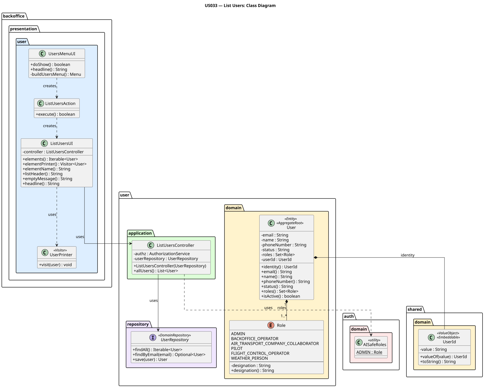

# US033 — List Users

## User Story

> As an **Administrator**, I want to be able to list the users of the backoffice, including their status.

---

## Acceptance Criteria

| # | Criterion |
|---|-----------|
| AC1 | Only an authenticated **Admin** may list users. |
| AC2 | All registered users are shown, regardless of their status. |
| AC3 | Each row displays the user's email, name, phone number, and current status. |
| AC4 | If no users exist, a meaningful empty-state message is shown. |

---

## Implementation Overview

| Module | Role |
|--------|------|
| `aisafe.app.backoffice.console` | Interactive console UI (`ListUsersUI`, `ListUsersAction`) |
| `aisafe.core` | Application controller (`ListUsersController`) and domain model (`User`, `Role`) |

---

## Class Diagram



---

## Sequence Diagram


---

## User Interaction Flow

1. Administrator logs in and navigates to **List Users** from the Users menu.
2. `ListUsersController.allUsers()` verifies the caller has the `ADMIN` role via `AuthorizationService`.
3. All users are fetched from `UserRepository.findAll()`.
4. The console prints a fixed-width table header followed by one row per user:

```
EMAIL                          | NAME                 | PHONE                | STATUS
john.doe@aisafe.com            | John Doe             | +351912345678        | ACTIVE
bo@aisafe.com                  | Backoffice Ops       | +351000000000        | DISABLED
```

5. If no users are found, the console prints `No Users found.`

---

## Key Classes

| Class | Location | Responsibility |
|-------|----------|----------------|
| `ListUsersUI` | `backoffice.presentation.user` | Extends `AbstractListUI` — fetches users and renders the fixed-width table |
| `ListUsersAction` | `backoffice.presentation.user` | Menu action wiring — instantiates and shows `ListUsersUI` |
| `UserPrinter` | `backoffice.presentation.user` | Visitor that formats a `User` for display (ID, name, email, roles, status) |
| `ListUsersController` | `user.application` | Enforces ADMIN authorization and delegates to `UserRepository.findAll()` |
| `User` | `user.domain` | Aggregate root — exposes `email()`, `name()`, `phoneNumber()`, `status()`, `roles()` |
| `UserRepository` | `user.repository` | Domain repository interface — `findAll()` returns all persisted users |

---

## EAPLI Theoretical Principles — Practical Application

### Domain-Driven Design (DDD)

- **Ubiquitous Language**: "User," "Status," "Roles" form the shared vocabulary of user management.
- **Bounded Context**: User querying and display is isolated from user registration/modification logic.
- **Aggregate Root**: `User` exposes read-only accessors (`email()`, `name()`, `status()`) to ensure consistency.
- **Value Objects**: `Email`, `PhoneNumber`, `UserStatus` are immutable value objects with validation.
- **Repository Pattern**: `UserRepository.findAll()` abstracts persistence, allowing queries without SQL knowledge.

### Gang of Four Design Patterns

| Pattern | Application | Benefit |
|---------|------------|---------|
| **Repository** | `UserRepository.findAll()` provides collection-like query abstraction | Decouples domain from JPA/SQL queries |
| **Iterator** | `ListUsersUI` iterates over collection returned by repository | Separates traversal from entity structure |
| **DTO** | `UserDTO` carries user data for display without exposing mutable state | Safe field exposure |
| **Visitor** | `UserPrinter` formats user data for consistent table rendering | Separates display formatting from entity |

### SOLID Principles

- **Single Responsibility Principle (SRP)**: `User` manages data; `UserRepository` handles persistence; `ListUsersController` orchestrates queries; `UserPrinter` handles display formatting.
- **Open/Closed Principle (OCP)**: Adding new user fields does not require changing the query logic.
- **Liskov Substitution Principle (LSP)**: Any `UserRepository` implementation can replace another without breaking queries.
- **Interface Segregation Principle (ISP)**: `UserRepository` exposes only the queries needed (`findAll()`); other methods are not forced.
- **Dependency Inversion Principle (DIP)**: `ListUsersController` depends on `UserRepository` abstraction, not concrete implementations.

### Data Transfer Objects (DTOs)

- **UserDTO**: Carries email, name, phone, roles, status for display — never exposes internal mutable state.
- **Benefit**: Internal changes to `User` (e.g., adding password history) do not affect presentation layer.

### Repository Query Pattern

The repository abstracts away complexity:

```java
// UI doesn't need to know SQL or ORM details
List<User> allUsers = userRepository.findAll();
for (User user : allUsers) {
    displayUserRow(user.email(), user.name(), user.phoneNumber(), user.status());
}
```
