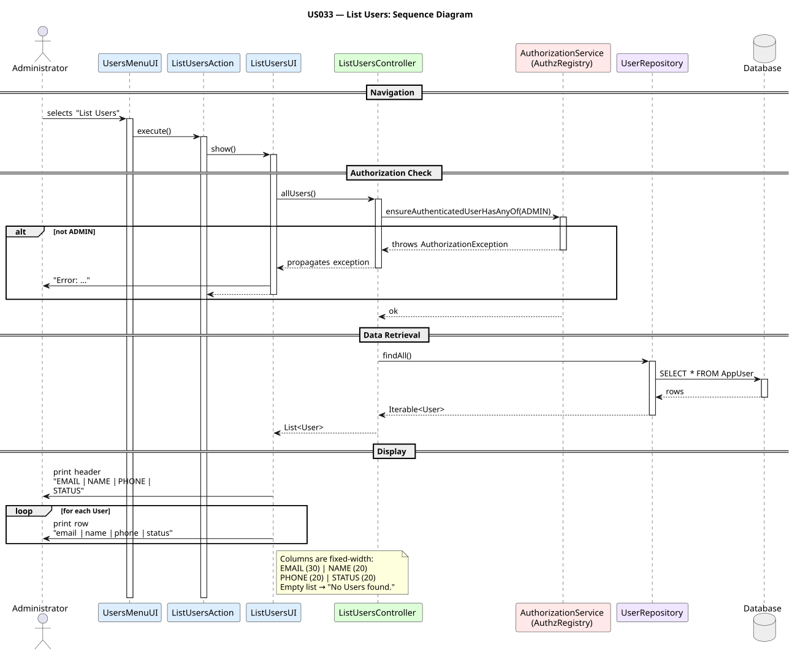

# US033 — List Users

## User Story

> As an **Administrator**, I want to be able to list the users of the backoffice, including their status.

---

## Acceptance Criteria

| # | Criterion |
|---|-----------|
| AC1 | Only an authenticated **Admin** may list users. |
| AC2 | All registered users are shown, regardless of their status. |
| AC3 | Each row displays the user's email, name, phone number, and current status. |
| AC4 | If no users exist, a meaningful empty-state message is shown. |

---

## Implementation Overview

| Module | Role |
|--------|------|
| `aisafe.app.backoffice.console` | Interactive console UI (`ListUsersUI`, `ListUsersAction`) |
| `aisafe.core` | Application controller (`ListUsersController`) and domain model (`User`, `Role`) |

---

## Class Diagram


---

## Sequence Diagram



---

## User Interaction Flow

1. Administrator logs in and navigates to **List Users** from the Users menu.
2. `ListUsersController.allUsers()` verifies the caller has the `ADMIN` role via `AuthorizationService`.
3. All users are fetched from `UserRepository.findAll()`.
4. The console prints a fixed-width table header followed by one row per user:

```
EMAIL                          | NAME                 | PHONE                | STATUS
john.doe@aisafe.com            | John Doe             | +351912345678        | ACTIVE
bo@aisafe.com                  | Backoffice Ops       | +351000000000        | DISABLED
```

5. If no users are found, the console prints `No Users found.`

---

## Key Classes

| Class | Location | Responsibility |
|-------|----------|----------------|
| `ListUsersUI` | `backoffice.presentation.user` | Extends `AbstractListUI` — fetches users and renders the fixed-width table |
| `ListUsersAction` | `backoffice.presentation.user` | Menu action wiring — instantiates and shows `ListUsersUI` |
| `UserPrinter` | `backoffice.presentation.user` | Visitor that formats a `User` for display (ID, name, email, roles, status) |
| `ListUsersController` | `user.application` | Enforces ADMIN authorization and delegates to `UserRepository.findAll()` |
| `User` | `user.domain` | Aggregate root — exposes `email()`, `name()`, `phoneNumber()`, `status()`, `roles()` |
| `UserRepository` | `user.repository` | Domain repository interface — `findAll()` returns all persisted users |
