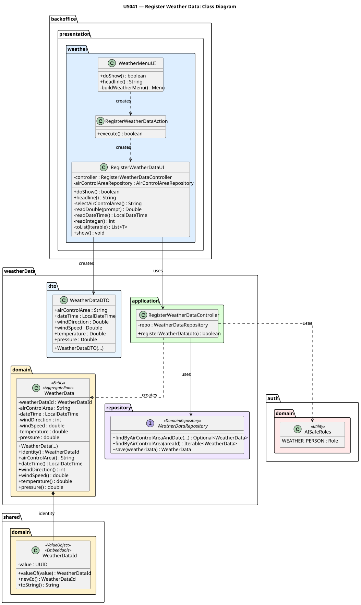
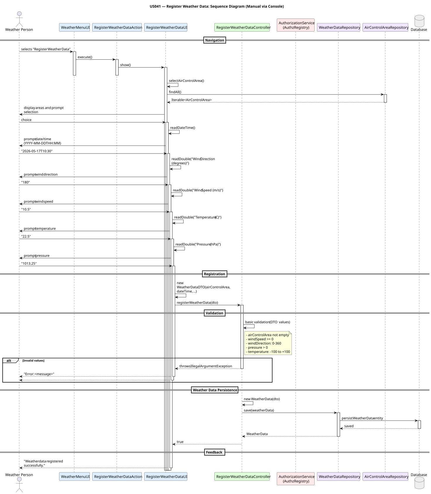

# US041 — Register Weather Data

## User Story

> As a **Weather Person**, I want to register weather data in the system for a specific air control area.

---

## Acceptance Criteria

| # | Criterion |
|---|-----------|
| AC01 | Only an authenticated **Weather Person** can register weather data |
| AC02 | Weather data must be associated with an existing air control area |
| AC03 | Required fields include: air control area, date/time, wind direction, wind speed, temperature, and pressure |
| AC04 | All numeric values (wind speed, temperature, pressure) must be valid |
| AC05 | Date and time values must represent valid calendar values |
| AC06 | Registering weather data for a non-existent air control area must be rejected with a meaningful error |

---

## Class Diagram

---

## Sequence Diagram — Manual Registration (Console)

---

## Implementation Overview

| Module | Role |
|--------|------|
| `aisafe.app.backoffice.console` | Interactive console UI (`RegisterWeatherDataUI`, `RegisterWeatherDataAction`) |
| `aisafe.core` | Application controller (`RegisterWeatherDataController`) and domain model (`WeatherData`, `AirControlArea`) |
| `aisafe.infrastructure.application` | Repository implementation (`WeatherDataRepository`, `AirControlAreaRepository`) |

---

## User Interaction Flow

1. Weather Person logs in and navigates to **Register Weather Data** from the Weather menu.
2. The console prompts for:
   - Air Control Area (select from existing list or enter identifier)
   - Date and Time (YYYY-MM-DD HH:MM:SS format)
   - Wind Direction (0-360 degrees)
   - Wind Speed (m/s, non-negative)
   - Temperature (Celsius)
   - Pressure (hPa, positive value)
3. `RegisterWeatherDataController` verifies the caller has the `WEATHER_PERSON` role via `AuthorizationService`.
4. The controller validates:
   - Air Control Area exists in the system
   - All numeric fields are within valid ranges
   - Date/time values are valid calendar dates
5. A domain `WeatherData` entity is created and saved via `WeatherDataRepository`.
6. The console prints `Weather data registered successfully.`

---

## Key Classes

| Class | Location | Responsibility |
|-------|----------|----------------|
| `RegisterWeatherDataUI` | `backoffice.presentation.weather` | Console form — collects input, delegates to controller |
| `RegisterWeatherDataAction` | `backoffice.presentation.weather` | Menu action wiring — instantiates and shows `RegisterWeatherDataUI` |
| `RegisterWeatherDataController` | `weather.application` | Enforces WEATHER_PERSON authorization, validates air control area, persists weather data |
| `WeatherData` | `weather.domain` | Aggregate root — holds air control area, timestamp, wind data, temperature, pressure |
| `WeatherDataId` | `shared.domain` | Value object used as the aggregate identity |
| `AirControlArea` | `aircontrol.domain` | Referenced entity — must exist in system for weather data association |
| `WeatherDataRepository` | `weather.repository` | Domain repository interface for persisting and querying weather data |

---

## Test Cases

### TC01 – Successful weather data registration
**Given** an authenticated Weather Person and an existing air control area  
**When** they submit valid weather data (wind direction, speed, temperature, pressure, date/time)  
**Then** the system saves the weather data and confirms success

### TC02 – Registration for non-existent air control area rejected
**Given** an operator references a non-existent air control area  
**When** the form is submitted  
**Then** the system rejects the registration with a meaningful error message

### TC03 – Invalid numeric values rejected
**Given** a Weather Person submits a negative wind speed value  
**When** the form is submitted  
**Then** the system rejects the registration with a validation error

### TC04 – Invalid date/time rejected
**Given** a Weather Person submits an invalid date (e.g., 2026-13-45)  
**When** the form is submitted  
**Then** the system rejects the registration with an appropriate error

### TC05 – Missing required fields rejected
**Given** a Weather Person submits weather data without specifying wind direction  
**When** the form is submitted  
**Then** the system rejects the registration and indicates the missing field

### TC06 – Weather data consultable after registration
**Given** weather data has been successfully registered for an area on a given date  
**When** a Weather Person, Pilot, or FCO consults weather data (US062) for that area and date  
**Then** the registered data is returned correctly

### TC07 – Non-Weather Person cannot register weather data
**Given** an authenticated user with role Pilot  
**When** they attempt to register weather data  
**Then** the system denies access with a 403/Forbidden error

---

## Done Concept

- A Weather Person can register weather data for a specific air control area
- Required fields are provided: air control area, date/time, and weather parameters (e.g., wind direction, wind speed, temperature, pressure)
- The air control area must already exist in the system
- Only authenticated Weather Persons can perform this action
- Test coverage of controller and domain packages ≥ 90%
- Code compiles and all tests pass
- Technical documentation updated in the repository (analysis, design, tests) in Markdown format
