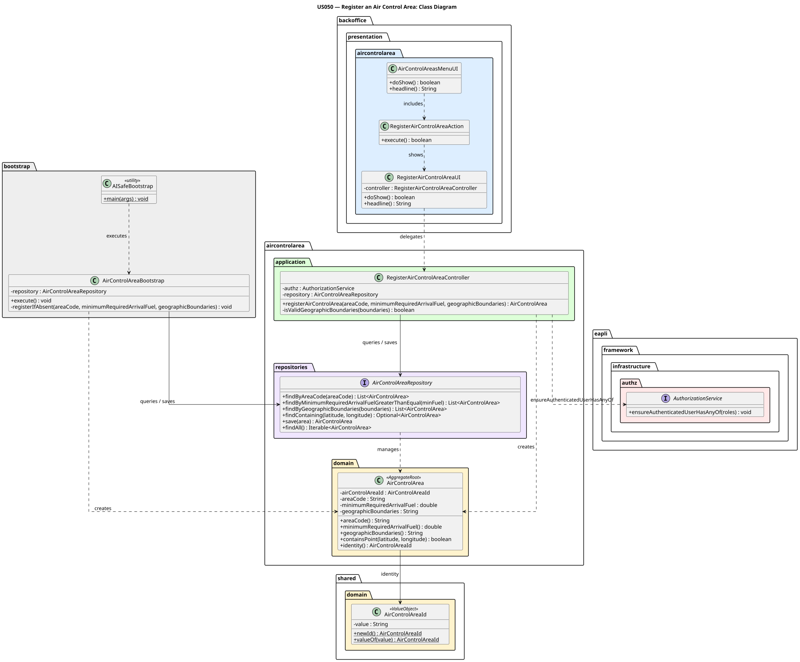
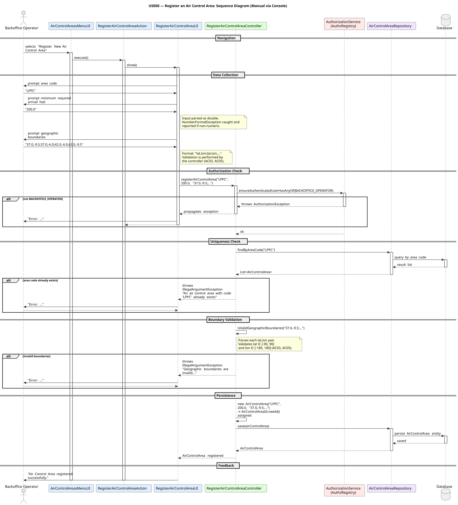

# US050 — Register an Air Control Area

## User Story

> As a **Backoffice Operator**, I want to register an air control area.
> An air control area has an area code, a minimum required arrival fuel, and geographic boundaries.
> This must also be achievable by a bootstrap process.

---

## Acceptance Criteria

| # | Criterion |
|---|-----------|
| AC01 | Only an authenticated **Backoffice Operator** may register an air control area. |
| AC02 | The area code must be unique — no two areas may share the same code. |
| AC03 | Geographic boundaries must be valid: format `lat,lon;lat,lon;...`, latitude ∈ [-90, 90], longitude ∈ [-180, 180]. |
| AC04 | A duplicate area code is rejected with a descriptive error message. |
| AC05 | Invalid geographic boundaries are rejected with a descriptive error message. |
| AC06 | The bootstrap process pre-loads a set of real-world air control areas if they do not already exist (idempotent). |

---

## Implementation Overview

| Module | Role |
|--------|------|
| `aisafe.app.backoffice.console` | Interactive console UI (`RegisterAirControlAreaUI`, `RegisterAirControlAreaAction`) |
| `aisafe.core` | Application controller (`RegisterAirControlAreaController`) and domain model (`AirControlArea`) |
| `aisafe.app.bootstrap` | Seed data (`AirControlAreaBootstrap`, `AISafeBootstrap`) |

---

## Class Diagram



---

## Sequence Diagram — Manual Registration (Console)



---

## User Interaction Flow

1. Backoffice Operator navigates to **Register New Air Control Area** from the menu.
2. The console prompts for:
   - Area code (e.g. `LPPC`)
   - Minimum required arrival fuel — a non-negative decimal (e.g. `200.0`)
   - Geographic boundaries — semicolon-separated `lat,lon` pairs (e.g. `37.0,-9.5;37.0,-6.0;42.0,-6.0;42.0,-9.5`)
3. `RegisterAirControlAreaController` enforces the `BACKOFFICE_OPERATOR` role (AC01).
4. The controller validates that the area code is non-empty and unique in the repository (AC02, AC04).
5. The controller validates the geographic boundaries format and coordinate ranges (AC03, AC05).
6. A new `AirControlArea` is created (with a generated `AirControlAreaId`) and persisted.
7. The console prints `Air Control Area registered successfully.`

---

## Bootstrap Process

`AISafeBootstrap.main()` calls `AirControlAreaBootstrap.execute()`, which seeds the following areas if they do not already exist:

| Area Code | Min Fuel | Description |
|-----------|----------|-------------|
| LPPC | 200.0 | Lisbon FIR (Portugal Continental) |
| LPPO | 180.0 | Santa Maria Oceanic FIR (Azores) |
| LPMA | 150.0 | Madeira TMA |
| GCCC | 150.0 | Canarias FIR |
| LECM | 220.0 | Madrid FIR |
| LFFF | 250.0 | Paris FIR |
| EDGG | 230.0 | Langen FIR (Germany) |
| EGTT | 210.0 | London FIR |
| EISN | 200.0 | Shannon FIR (Ireland) |
| BIRD | 250.0 | Reykjavik FIR (Iceland) |
| ENOR | 220.0 | Norway FIR |
| EBBU | 190.0 | Brussels FIR |
| EHAA | 195.0 | Amsterdam FIR |
| LIBB | 240.0 | Roma FIR |
| LSAS | 180.0 | Switzerland FIR |
| KUSA | 300.0 | USA FIR (broad box) |
| PHZH | 200.0 | Hawaii FIR |
| CZEG | 250.0 | Canada FIR (broad box) |
| MMFR | 200.0 | Mexico FIR |
| SKED | 200.0 | Colombia/North SA FIR |
| SBAZ | 300.0 | Brazil FIR (broad box) |
| UUWV | 300.0 | Russia/Kazakhstan FIR |
| FAJA | 250.0 | South Africa FIR |
| FZZA | 250.0 | Central Africa FIR |
| RJJJ | 250.0 | Japan FIR |
| ZBAA | 300.0 | China FIR (broad box) |
| WSJC | 250.0 | SE Asia FIR |
| YBBB | 300.0 | Australia FIR |

Uniqueness is checked by area code before each insert — re-running bootstrap does not create duplicates (AC06).

---

## Geographic Boundaries Format

Boundaries are stored as a `String` in the format:

```
lat1,lon1;lat2,lon2;lat3,lon3;...
```

Each `lat,lon` pair defines a vertex of the bounding polygon. The `AirControlArea.containsPoint(lat, lon)` method uses a **ray-casting algorithm** to determine whether a given point lies inside the polygon. At least 3 vertices are required for a valid polygon.

**Validation rules (enforced by the controller):**
- Latitude must be in the range `[-90, 90]`
- Longitude must be in the range `[-180, 180]`
- Each entry must have exactly two comma-separated values
- The overall string must be non-empty

---

## Key Classes

| Class | Location | Responsibility |
|-------|----------|----------------|
| `RegisterAirControlAreaUI` | `backoffice.presentation.aircontrolarea` | Console form — collects area code, fuel, and boundaries; delegates to controller |
| `RegisterAirControlAreaAction` | `backoffice.presentation.aircontrolarea` | Menu action wiring — instantiates and shows `RegisterAirControlAreaUI` |
| `RegisterAirControlAreaController` | `aircontrolarea.application` | Enforces `BACKOFFICE_OPERATOR` authorization, validates code uniqueness and boundary format, persists |
| `AirControlArea` | `aircontrolarea.domain` | Aggregate root — holds area code, minimum fuel, geographic boundaries, and a generated identity; provides `containsPoint()` |
| `AirControlAreaId` | `shared.domain` | UUID-based value object used as the aggregate identity |
| `AirControlAreaRepository` | `aircontrolarea.repositories` | Domain repository — `findByAreaCode`, `findContaining`, `save` |
| `AirControlAreaBootstrap` | `bootstrap` | Seeds 28 real-world FIR/TMA areas on first run; idempotent |
| `AISafeBootstrap` | `bootstrap` | Application bootstrap entry point — orchestrates all seed data loaders |
