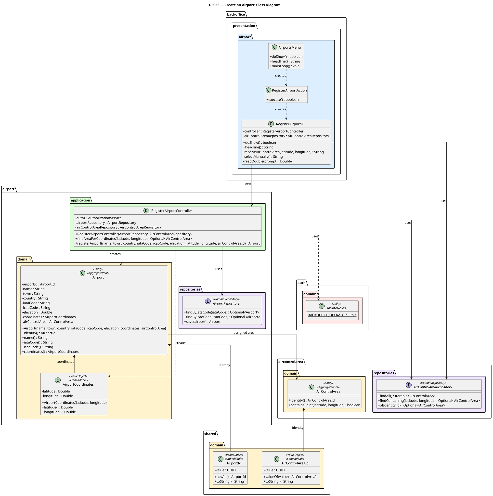
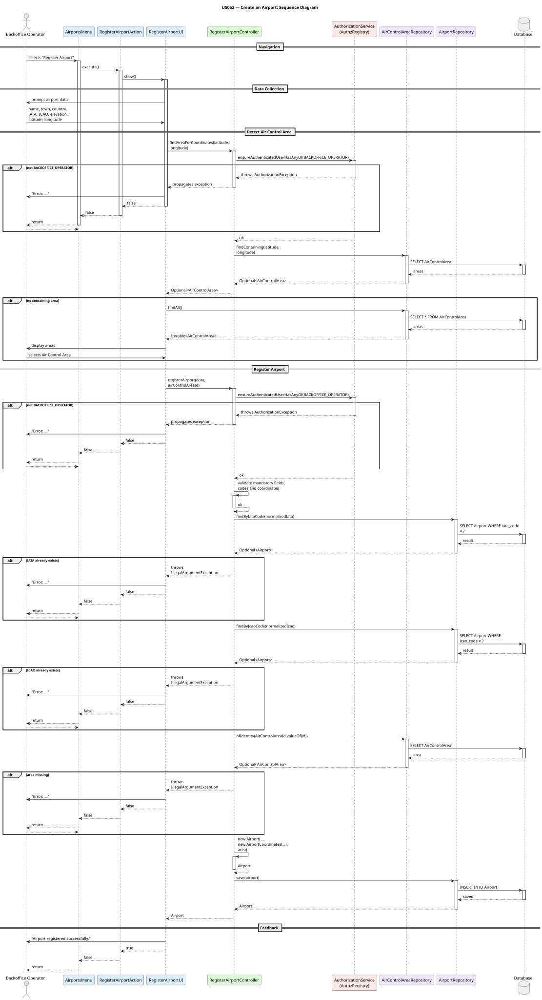

# US052 — Register Airport

## User Story

> As a **Backoffice Operator**, I want to register an airport in a given air control area. An airport must be associated with exactly one air control area. The airport has an ICAO and IATA code that must be unique worldwide. An airport has location coordinates that must be valid and an elevation in meters above sea level. This must also be achieved by a bootstrap process.

---

## Acceptance Criteria

| # | Criterion |
|---|-----------|
| AC01 | Only an authenticated **Backoffice Operator** can register an airport |
| AC02 | Each airport must be associated with exactly one existing air control area |
| AC03 | The IATA code (3 letters) must be unique worldwide |
| AC04 | The ICAO code (4 letters) must be unique worldwide |
| AC05 | Location coordinates must be valid (latitude ∈ [-90,90], longitude ∈ [-180,180]) |
| AC06 | Elevation must be a numeric value in meters above sea level (non-negative) |
| AC07 | Registering with duplicate IATA or ICAO codes must be rejected |
| AC08 | The bootstrap process must be able to pre-load airports on system startup |

---

## Implementation Overview

| Module | Role |
|--------|------|
| `aisafe.app.backoffice.console` | Console UI for registering airports (`RegisterAirportUI`, `RegisterAirportAction`) |
| `aisafe.core` | Application controller (`RegisterAirportController`) and domain model (`Airport`) |
| `aisafe.app.bootstrap` | Seed data loader for airports (`AirportBootstrap`) |

---

## EAPLI Theoretical Principles — Practical Application

### Domain-Driven Design (DDD)

- Ubiquitous Language: consistent domain terms (e.g., `Airport`, `AirControlArea`, `IataCode`, `IcaoCode`).
- Bounded Context: airport management lives in its own context and communicates with shared contexts via repositories and DTOs.
- Aggregate Root: `Airport` is the aggregate root; invariants such as unique IATA/ICAO codes are enforced at aggregate/repository level.

### Gang of Four (GoF) Patterns

| Pattern | Location | Purpose |
|--------|---------|--------|
| **Factory** | `AirportFactory` or controller | Builds validated `Airport` aggregates from DTOs or raw input.
| **Repository** | `AirportRepository` | Persistence abstraction and uniqueness checks.
| **Adapter** | Console UI → Controller | Adapts user input into application commands.
| **DTO** | `RegisterAirportRequest` | Transport data between UI and application layer.

### SOLID Principles

1. **Single Responsibility Principle (SRP)** — each class has one responsibility (UI, controller, domain, repository).
2. **Open/Closed Principle (OCP)** — services can be extended (e.g., validation rules) without modifying clients.
3. **Liskov Substitution Principle (LSP)** — repository implementations are interchangeable.
4. **Interface Segregation Principle (ISP)** — clients depend on small, specific interfaces.
5. **Dependency Inversion Principle (DIP)** — controllers depend on abstractions (repositories, authorization services).

### DTOs and Factory

- DTOs decouple UI input from domain entities and enable stable interfaces for future APIs.
- Factories encapsulate complex validation and creation logic for aggregates, ensuring valid state at creation.

## Class Diagram

---

## Sequence Diagram — Manual Registration (Console)

---

## User Interaction Flow

1. Backoffice Operator selects **Register Airport** from the menu.
2. Console prompts for: name, IATA (3 letters), ICAO (4 letters), air control area id, latitude, longitude, elevation (meters).
3. `RegisterAirportController` verifies caller has `BACKOFFICE_OPERATOR` role.
4. Controller validates formats and uniqueness of IATA/ICAO, validates coordinate ranges and elevation, verifies referenced air control area exists.
5. On success, a new `Airport` aggregate is created and persisted; UI shows success message.

---

## Bootstrap Process

`AISafeBootstrap` calls `AirportBootstrap.execute()` which reads seed airport definitions and inserts them if uniqueness checks pass. The bootstrap loader is idempotent and will not create duplicates when re-run.

---

## Key Classes

| Class | Location | Responsibility |
|-------|----------|----------------|
| `RegisterAirportUI` | `backoffice.presentation.airport` | Console form — collects airport fields and calls controller |
| `RegisterAirportController` | `airport.application` | Authorizes operator, validates fields, checks uniqueness, persists `Airport` |
| `Airport` | `airport.domain` | Aggregate root — identity, IATA, ICAO, coordinates, elevation, association to AirControlArea |
| `AirportRepository` | `airport.repositories` | Persistence with `findByIataCode`, `findByIcaoCode`, `save` |
| `AirportBootstrap` | `bootstrap` | Loads seed airports at startup (idempotent) |

---

## Domain Notes

- Use value objects for `IataCode` (3 letters), `IcaoCode` (4 letters), and `Coordinates` (latitude/longitude with range validation).
- Enforce uniqueness in repository layer and validate in domain/service before saving.
- Bootstrap must be idempotent: check repository by IATA/ICAO before insertion.

