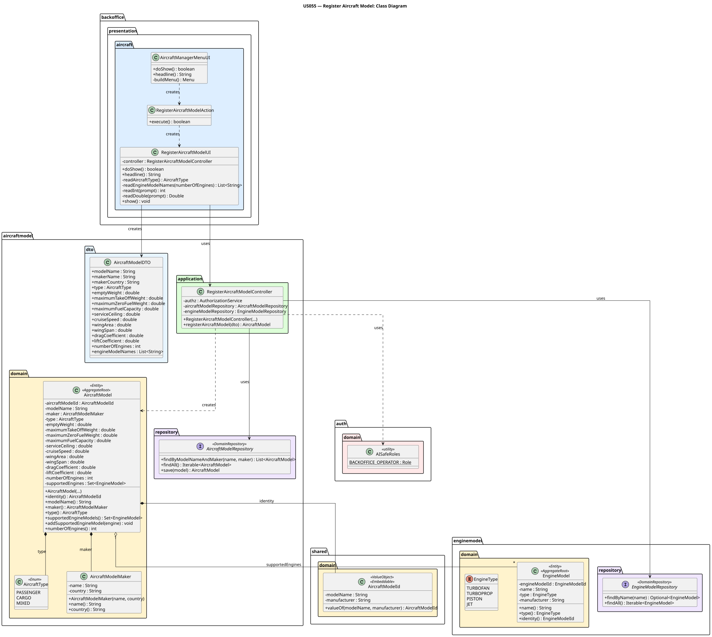
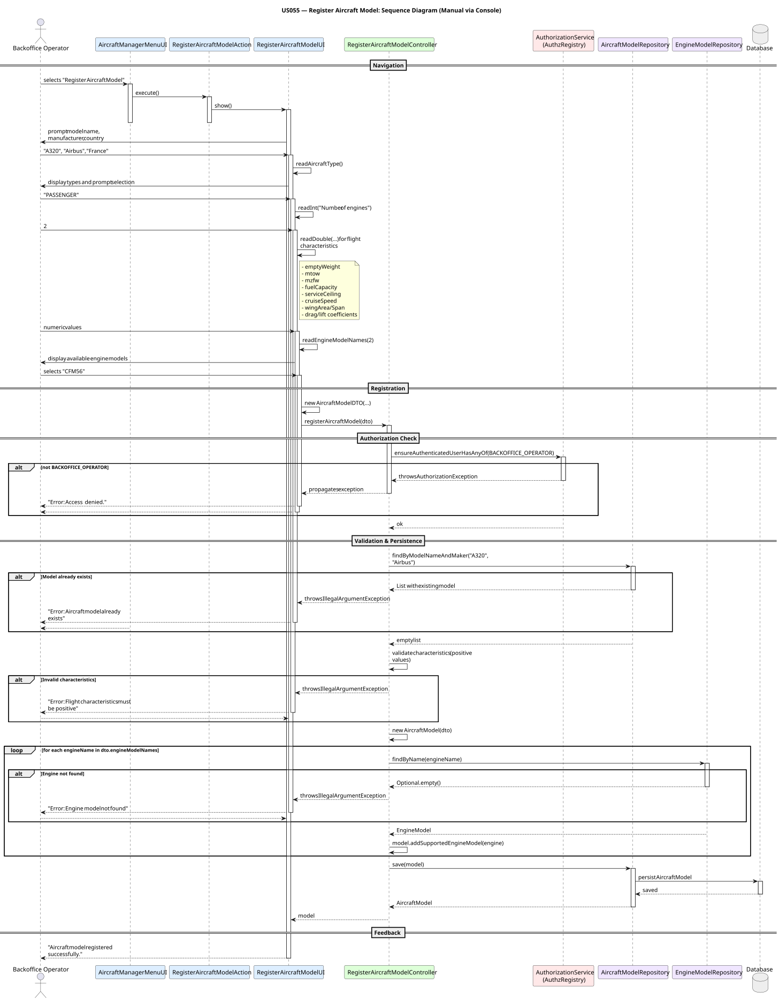

# US055 — Register Aircraft Model

## User Story

> As a **Backoffice Operator**, I want to register a new aircraft model. Any model must have at least one engine model. Aircraft has a model name and manufacturer, and their combination must be unique. At least one certified engine model must be associated. An aircraft model will have a type, maximum range and other flight characteristics. This must also be achieved by a bootstrap process.

---

## Acceptance Criteria

| # | Criterion |
|---|-----------|
| AC01 | Only an authenticated **Backoffice Operator** can register an aircraft model |
| AC02 | The combination of model name + manufacturer must be unique in the system |
| AC03 | At least one certified engine model must be associated at creation time |
| AC04 | The model type must be one of the allowed values: passenger, cargo, or mixed |
| AC05 | All required flight characteristics must be provided and valid (positive numeric values) |
| AC06 | Registering a model with a duplicate name + manufacturer combination must be rejected |
| AC07 | Registering a model without any engine model must be rejected |
| AC08 | The bootstrap process must be able to pre-load aircraft models on system startup |

---

## Class Diagram



---

## Sequence Diagram — Register Aircraft Model (Console)



---

## Implementation Overview

| Module | Role |
|--------|------|
| `aisafe.app.backoffice.console` | Interactive console UI (`RegisterAircraftModelUI`, `RegisterAircraftModelAction`) |
| `aisafe.core` | Application controller (`RegisterAircraftModelController`) and domain model (`AircraftModel`, `EngineModel`, `AircraftType`) |
| `aisafe.infrastructure.application` | Repository implementation (`AircraftModelRepository`, `EngineModelRepository`) |
| `aisafe.app.bootstrap` | Seed data (`AircraftModelsBootstrap`, `EngineModelsBootstrap`) |

---

## EAPLI Theoretical Principles — Practical Application

### Domain-Driven Design (DDD)

The design of US055 follows central DDD principles:

- **Ubiquitous Language**: Code terms reflect the aircraft domain (`AircraftModel`, `EngineModel`, `AircraftType`, `certified engines`, `manufacturer`).
- **Bounded Context**: This feature belongs to the aircraft model management bounded context, separate from other subdomains such as weather or operations.
- **Aggregate Root**: `AircraftModel` is the aggregate root that holds model data, flight characteristics and the list of certified engines.
- **Value Objects**: `AircraftModelId` and supporting types represent identity and domain rules consistently.
- **Entities**: `EngineModel` and `AircraftModel` are domain entities with their own lifecycle managed by repositories.
- **Repository Pattern**: `AircraftModelRepository` and `EngineModelRepository` isolate persistence from application logic.

### Gang of Four (GoF) Patterns

| Pattern | Location | Purpose |
|--------|-------|----------|
| **Factory** | `RegisterAircraftModelController` / `AircraftModelsBootstrap` | Centralizes creation of the `AircraftModel` aggregate after input validation |
| **Repository** | `AircraftModelRepository`, `EngineModelRepository` | Abstracts data access and avoids tight coupling to persistence technology |
| **Strategy** | Authorization rules via `AuthorizationService` | Allows varying access policy by role without changing core logic |
| **DTO** | Request/command between UI and controller | Carries form data without exposing domain entities |

### SOLID Principles

The US055 architecture follows the five SOLID principles:

1. **Single Responsibility Principle (SRP)**
   - `RegisterAircraftModelUI`: collects and displays input only
   - `RegisterAircraftModelController`: coordinates validation and creation
   - `AircraftModel`: contains domain rules for aircraft models

2. **Open/Closed Principle (OCP)**
   - New aircraft types, validation rules or data sources can be added without rewriting the main flow.

3. **Liskov Substitution Principle (LSP)**
   - Alternative repository implementations can substitute the current ones without breaking the controller behavior.

4. **Interface Segregation Principle (ISP)**
   - Repository contracts expose only the operations necessary to register and query models and engines.

5. **Dependency Inversion Principle (DIP)**
   - The controller depends on abstractions (`AircraftModelRepository`, `EngineModelRepository`, `AuthorizationService`) rather than concrete implementations.

### Data Transfer Objects (DTOs)

DTOs are used to isolate the presentation layer from the domain:

- **Input DTO**: carries form fields (`model name`, `manufacturer`, `type`, `performance data`, `selected engines`).
- **Benefit**: the UI does not manipulate the `AircraftModel` aggregate directly, reducing coupling and easing validation.
- **Result**: the controller converts received data into a valid aggregate before persisting.

### Factory Pattern

The Factory pattern appears when the aggregate is created after validation:

```java
// Conceptual example of aggregate creation after validation
AircraftModel aircraftModel = AircraftModel.create(
    modelName,
    manufacturer,
    aircraftType,
    maxRange,
    emptyWeight,
    mtow,
    mzfw,
    cruiseSpeed,
    wingArea,
    dragCoefficient,
    liftCoefficient,
    serviceCeiling,
    selectedEngines
);
```

Factory responsibilities:
- Ensure the aggregate is created in a valid state
- Encapsulate initial validation and composition logic
- Keep the controller focused on coordinating the use case

---

## User Interaction Flow

1. Backoffice Operator logs in and navigates to **Register Aircraft Model** from the Aircraft Management menu.
2. The console prompts for:
   - Model Name (unique identifier)
   - Manufacturer (e.g. "Airbus", "Boeing", "Embraer")
   - Aircraft Type (passenger, cargo, mixed)
   - Max Range (km)
   - Empty Weight (kg)
   - MTOW — Maximum Takeoff Weight (kg)
   - MZFW — Maximum Zero Fuel Weight (kg)
   - Cruise Speed (m/s)
   - Wing Area (m²)
   - Cd — Drag Coefficient (dimensionless)
   - Cl — Lift Coefficient (dimensionless)
   - Service Ceiling (meters)
   - Select at least one existing engine model
3. `RegisterAircraftModelController` verifies the caller has the `BACKOFFICE_OPERATOR` role.
4. The controller validates:
   - Model name + manufacturer combination is unique
   - At least one engine model is selected
   - Aircraft type is valid (passenger | cargo | mixed)
   - All numeric fields are positive values
   - Flight characteristics are physically plausible (MZFW ≤ MTOW, etc.)
5. A domain `AircraftModel` entity is created and persisted via `AircraftModelRepository`.
6. The selected engine models are associated with the aircraft model.
7. The console prints `Aircraft model registered successfully.`

---

## Bootstrap Process

`AircraftModelsBootstrap.execute()` pre-loads common aircraft models on system startup, but only if they do not already exist (idempotent). Example seed data:

| Model | Manufacturer | Type | Engines |
|-------|--------------|------|---------|
| A320 | Airbus | Passenger | CFM56 |
| B737 | Boeing | Passenger | CFM56, CFM97 |
| E190 | Embraer | Passenger | GE CF34 |
| A330-200 | Airbus | Mixed | Rolls-Royce Trent 700 |
| B747-8F | Boeing | Cargo | GE GEnx-2B |

---

## Key Classes

| Class | Location | Responsibility |
|-------|----------|----------------|
| `RegisterAircraftModelUI` | `backoffice.presentation.aircraft` | Console form — collects input, validates input, delegates to controller |
| `RegisterAircraftModelAction` | `backoffice.presentation.aircraft` | Menu action wiring — instantiates and shows `RegisterAircraftModelUI` |
| `RegisterAircraftModelController` | `aircraft.application` | Enforces BACKOFFICE_OPERATOR authorization, validates uniqueness and engine association, persists aircraft model |
| `AircraftModel` | `aircraft.domain` | Aggregate root — holds model name, manufacturer, type, range, weight, performance characteristics, and certified engines list |
| `AircraftType` | `aircraft.domain` | Enum: PASSENGER, CARGO, MIXED |
| `EngineModel` | `aircraft.domain` | Referenced entity — represents a specific engine make/model that can be certified for use |
| `AircraftModelId` | `shared.domain` | Value object used as aggregate identity, keyed on (modelName, manufacturer) tuple |
| `AircraftModelRepository` | `aircraft.repository` | Domain repository for persisting and querying aircraft models |
| `EngineModelRepository` | `aircraft.repository` | Domain repository for querying existing engine models |
| `AircraftModelsBootstrap` | `bootstrap` | Seeds default aircraft models on first run; idempotent |

---

## Test Cases

### TC01 – Successful aircraft model registration
**Given** an authenticated Backoffice Operator and at least one existing engine model  
**When** they submit a unique name + manufacturer combination with all required characteristics  
**Then** the system creates the aircraft model and confirms success

### TC02 – Duplicate name + manufacturer combination rejected
**Given** an aircraft model A320 by Airbus already exists  
**When** an operator tries to register another model with the same name and manufacturer  
**Then** the system rejects the registration with a meaningful error message

### TC03 – Registration without engine model rejected
**Given** an operator submits an aircraft model registration with no engine model associated  
**When** the form is submitted  
**Then** the system rejects the registration with an appropriate error

### TC04 – Invalid flight characteristics rejected
**Given** an operator submits an aircraft model with a negative MTOW value  
**When** the form is submitted  
**Then** the system rejects the registration with a validation error

### TC05 – Invalid type rejected
**Given** an operator submits an aircraft model with an unrecognized type (e.g., military)  
**When** the form is submitted  
**Then** the system rejects the registration with an appropriate error

### TC06 – Bootstrap process creates aircraft models
**Given** the system starts with a bootstrap configuration containing aircraft models  
**When** the bootstrap process runs  
**Then** all predefined models are created and available in the system

### TC07 – Non-Backoffice Operator cannot register an aircraft model
**Given** an authenticated user with role Pilot  
**When** they attempt to register an aircraft model  
**Then** the system denies access with a 403/Forbidden error

---

## Done Concept

- A Backoffice Operator can register a new aircraft model via the UI
- The combination of model name + manufacturer is validated as unique
- At least one certified engine model is associated at registration time
- All required flight characteristics are provided (type, max range, empty weight, MTOW, MZFW, cruise speed, wing area, Cd, Cl, service ceiling, etc.)
- The bootstrap process can pre-load aircraft models on system startup
- Only authenticated Backoffice Operators can perform this action
- Test coverage of controller and domain packages ≥ 90%
- Code compiles and all tests pass
- Technical documentation updated in the repository (analysis, design, tests) in Markdown format
