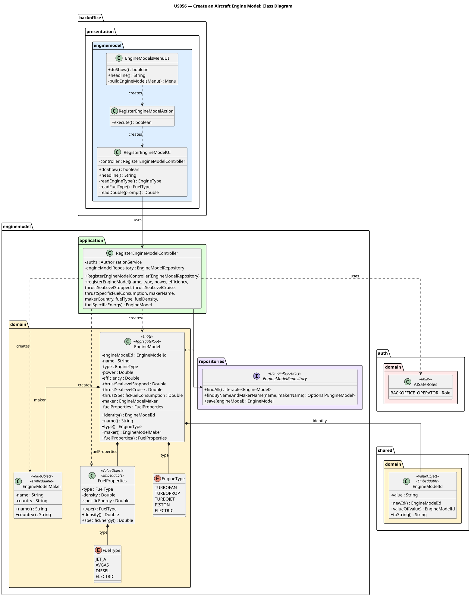
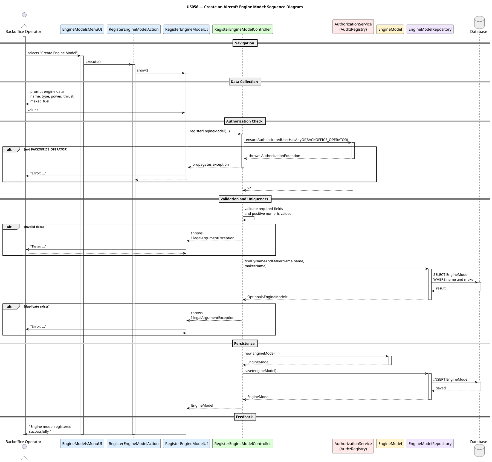

# US056 — Register Engine Model

## User Story

> As a **Backoffice Operator**, I want to register a new engine model to be used by aircraft. The model's name and manufacturer combination must be unique. Other important information regarding the type, power, fuel, and efficiency should be included. This must also be achievable by a bootstrap process.

---

## Acceptance Criteria

| # | Criterion |
|---|-----------|
| AC01 | Only an authenticated **Backoffice Operator** can register an engine model |
| AC02 | The combination of engine name + manufacturer must be unique in the system |
| AC03 | Engine type must be one of allowed types (e.g., turboprop, turbofan, turbojet, ramjet, electric-propeller) |
| AC04 | Power, fuel type, and efficiency (TSFC) must be provided with valid positive numeric values |
| AC05 | Registering an engine with duplicate name+manufacturer is rejected with a meaningful error |
| AC06 | Missing or invalid fields are rejected |
| AC07 | Bootstrap process can pre-load engine models on startup |

---

## Implementation Overview

| Module | Role |
|--------|------|
| `aisafe.app.backoffice.console` | Console UI (`RegisterEngineModelUI`, `RegisterEngineModelAction`) |
| `aisafe.core` | Application controller (`RegisterEngineModelController`) and domain model (`EngineModel`) |
| `aisafe.app.bootstrap` | Seed loader for engine models (`EngineModelBootstrap`) |

---

## EAPLI Theoretical Principles — Practical Application

### Domain-Driven Design (DDD)

- `EngineModel` is an aggregate representing immutable technical characteristics of an engine model.
- Use value objects for power, efficiency, and fuel type where appropriate.

### Gang of Four (GoF) Patterns

| Pattern | Location | Purpose |
|--------|---------|--------|
| **Factory** | `EngineModelFactory` | Encapsulates validated construction of `EngineModel` aggregates.
| **Repository** | `EngineModelRepository` | Encapsulates persistence and uniqueness checks (name+manufacturer).
| **DTO** | `RegisterEngineModelRequest` | Transfers registration input from UI to controller.

### SOLID Principles

1. **Single Responsibility Principle (SRP)**
   - Separate UI, application, domain, and persistence responsibilities.

2. **Open/Closed Principle (OCP)**
   - Allow new engine types, validation rules, or fuel options to be added without changing the existing controller flow.

3. **Liskov Substitution Principle (LSP)**
   - Any `EngineModelRepository` implementation should be substitutable without changing the registration use case behavior.

4. **Interface Segregation Principle (ISP)**
   - Prefer focused interfaces such as `EngineModelCreationRepository` instead of large repository contracts.

5. **Dependency Inversion Principle (DIP)**
   - Controllers depend on abstractions for repositories and authorization services, enabling test doubles and decoupling.

## Class Diagram

---

## Sequence Diagram — Manual Registration (Console)

---

## User Interaction Flow

1. Backoffice Operator selects **Register Engine Model**.
2. Console prompts for: model name, manufacturer, engine type, power (kW or shp), fuel type, efficiency (TSFC).
3. Controller authorizes caller and validates required fields, numeric ranges, and allowed engine types.
4. Controller checks uniqueness of (name, manufacturer) before persisting.
5. On success, `EngineModel` is persisted and UI reports success.

---

## Bootstrap Process

`EngineModelBootstrap` seeds a curated list of engine models. It checks existing repository entries by name+manufacturer before insertion to ensure idempotency.

---

## Key Classes

| Class | Location | Responsibility |
|-------|----------|----------------|
| `RegisterEngineModelUI` | `backoffice.presentation.engine` | Collects engine model fields and calls controller |
| `RegisterEngineModelController` | `engine.application` | Authorizes, validates, ensures uniqueness, persists `EngineModel` |
| `EngineModel` | `engine.domain` | Aggregate — name, manufacturer, type, power, fuelType, tsfc, identity |
| `EngineModelRepository` | `engine.repositories` | `findByNameAndManufacturer`, `save` |
| `EngineModelBootstrap` | `bootstrap` | Seeds engine models at application startup |

---

## Domain Notes

- Represent engine type as a closed set (enum) to validate allowed types.
- Use a composite uniqueness check (name + manufacturer) at repository level.
- Validate numeric fields (power, tsfc) to be positive numbers; record units in DTOs and docs.

