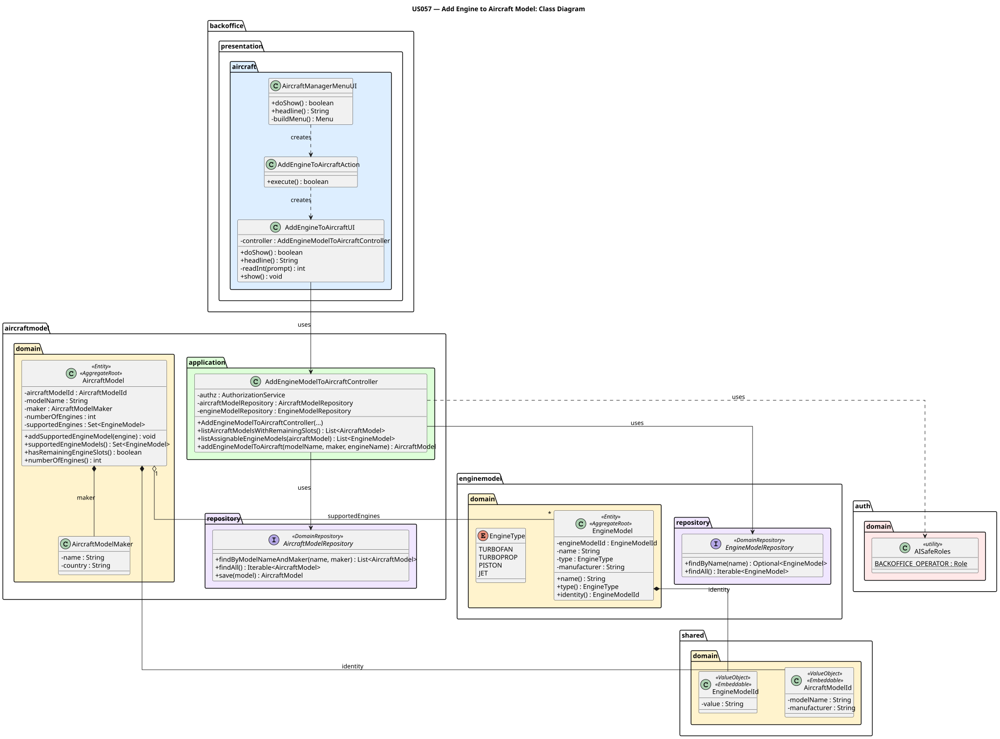
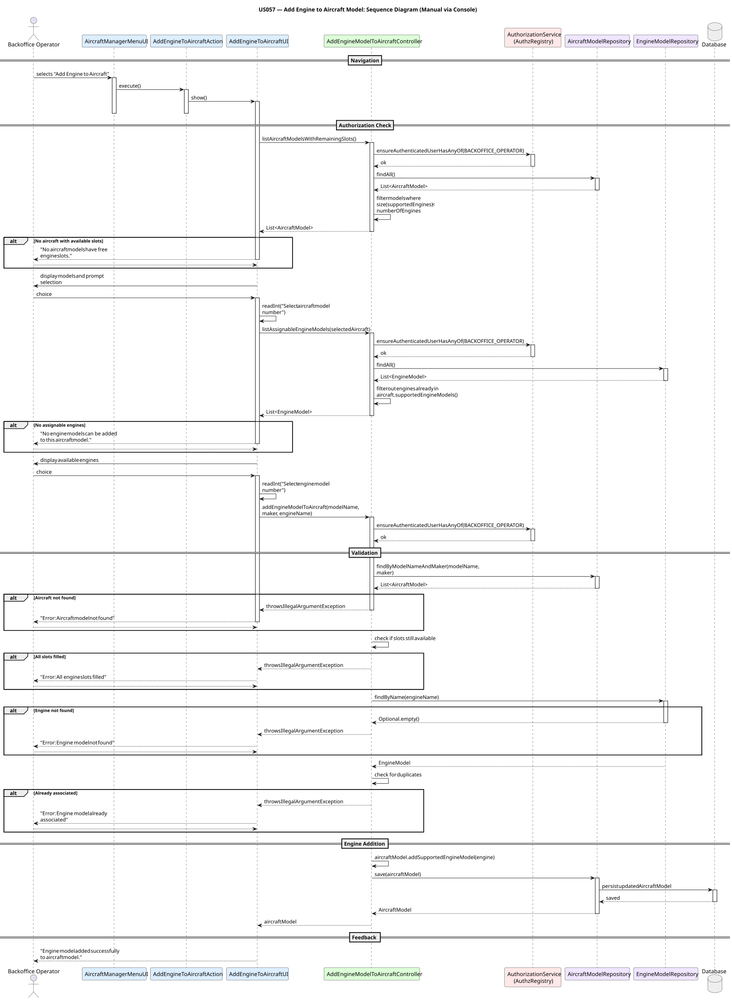

# US057 — Add Engine to Aircraft Model

## User Story

> As a **Backoffice Operator**, I want to add an engine model to an aircraft model's list of certified engines. Engine type must be compatible. The same engine model cannot be added twice to the same aircraft. An aircraft model might have several aircraft variants (combinations of model and engine configuration).

---

## Acceptance Criteria

| # | Criterion |
|---|-----------|
| AC01 | Only an authenticated **Backoffice Operator** can add an engine model to an aircraft model |
| AC02 | Both the aircraft model and the engine model must already exist in the system |
| AC03 | The engine type must be compatible with the aircraft model's motorization |
| AC04 | The same engine model cannot be added twice to the same aircraft model |
| AC05 | After a successful addition, the engine appears in the aircraft model's certified engines list |
| AC06 | Adding an incompatible engine type must be rejected with a meaningful error |
| AC07 | Adding a duplicate engine model must be rejected with a meaningful error |

---

## Class Diagram

---

## Sequence Diagram — Add Engine to Aircraft (Console)

---

## Implementation Overview

| Module | Role |
|--------|------|
| `aisafe.app.backoffice.console` | Interactive console UI (`AddEngineToAircraftUI`, `AddEngineToAircraftAction`) |
| `aisafe.core` | Application controller (`AddEngineToAircraftController`) and domain model (`AircraftModel`, `EngineModel`) |
| `aisafe.infrastructure.application` | Repository implementation (`AircraftModelRepository`, `EngineModelRepository`) |

---

## User Interaction Flow

1. Backoffice Operator logs in and navigates to **Add Engine to Aircraft Model** from the Aircraft Management menu.
2. The console prompts for:
   - Aircraft Model (select from existing list)
   - Engine Model (select from existing list of compatible engines)
3. `AddEngineToAircraftController` verifies the caller has the `BACKOFFICE_OPERATOR` role.
4. The controller validates:
   - Aircraft model exists in the system
   - Engine model exists in the system
   - Engine type is compatible with aircraft model's motorization
   - Engine model is not already associated with the aircraft model
5. The engine model is added to the aircraft model's certified engines list.
6. The domain `AircraftModel` is updated and persisted via `AircraftModelRepository`.
7. The console prints `Engine model added successfully to aircraft model.`

---

## Key Classes

| Class | Location | Responsibility |
|-------|----------|----------------|
| `AddEngineToAircraftUI` | `backoffice.presentation.aircraft` | Console form — selects aircraft and engine, delegates to controller |
| `AddEngineToAircraftAction` | `backoffice.presentation.aircraft` | Menu action wiring — instantiates and shows `AddEngineToAircraftUI` |
| `AddEngineToAircraftController` | `aircraft.application` | Enforces BACKOFFICE_OPERATOR authorization, validates compatibility and uniqueness, updates aircraft model |
| `AircraftModel` | `aircraft.domain` | Aggregate root — manages list of certified engines, validates compatibility rules |
| `EngineModel` | `aircraft.domain` | Referenced entity — represents engine specifications and type for compatibility checking |
| `EngineType` | `aircraft.domain` | Enum or value object for engine classification (turbofan, turboprop, piston, jet, etc.) |
| `AircraftModelRepository` | `aircraft.repository` | Domain repository for persisting and querying aircraft models |
| `EngineModelRepository` | `aircraft.repository` | Domain repository for querying existing engine models |

---

## Compatibility Rules

Engine compatibility is determined by:

1. **Engine Type Matching**: 
   - Aircraft model specifies required engine types (turbofan, turboprop, etc.)
   - Engine model must have a compatible type
   - Example: A320 requires turbofan → CFM56 (turbofan) is compatible, but MT7 (turboprop) is not

2. **Performance Envelope**:
   - Engine thrust/power must be within aircraft's designed operating range
   - Example: A320 requires engines in 24,000–30,000 lbf range

3. **Physical Fit**:
   - Engine must fit aircraft's pylon and installation points
   - Determined by aircraft form factor

---

## Test Cases

### TC01 – Successful addition of engine model to aircraft model
**Given** an authenticated Backoffice Operator, an existing aircraft model A320, and a compatible engine model CFM56  
**When** the operator adds CFM56 to A320's certified engines  
**Then** the system confirms success and CFM56 appears in A320's certified engine list

### TC02 – Duplicate engine model rejected
**Given** CFM56 is already in A320's certified engine list  
**When** an operator attempts to add CFM56 to A320 again  
**Then** the system rejects the operation with a meaningful error message

### TC03 – Incompatible engine type rejected
**Given** aircraft model A320 requires a turbofan engine  
**When** an operator attempts to add a turboprop engine to A320  
**Then** the system rejects the operation with an appropriate compatibility error

### TC04 – Aircraft model does not exist
**Given** an operator references a non-existent aircraft model  
**When** the operation is submitted  
**Then** the system rejects the operation with an appropriate error

### TC05 – Engine model does not exist
**Given** an operator references a non-existent engine model  
**When** the operation is submitted  
**Then** the system rejects the operation with an appropriate error

### TC06 – Non-Backoffice Operator cannot add engine to aircraft model
**Given** an authenticated user with role Pilot  
**When** they attempt to add an engine model to an aircraft model  
**Then** the system denies access with a 403/Forbidden error

### TC07 – Aircraft model has multiple certified engines after additions
**Given** an operator has successfully added two compatible engine models to the same aircraft model  
**When** the aircraft model's certified engines list is viewed  
**Then** both engine models appear in the list

---

## Done Concept

- A Backoffice Operator can add an existing engine model to an existing aircraft model
- The system validates that the engine type is compatible with the aircraft model
- The system prevents the same engine model from being added twice to the same aircraft model
- The aircraft model reflects the new engine in its list of certified engines
- Only authenticated Backoffice Operators can perform this action
- Test coverage of controller and domain packages ≥ 90%
- Code compiles and all tests pass
- Technical documentation updated in the repository (analysis, design, tests) in Markdown format

