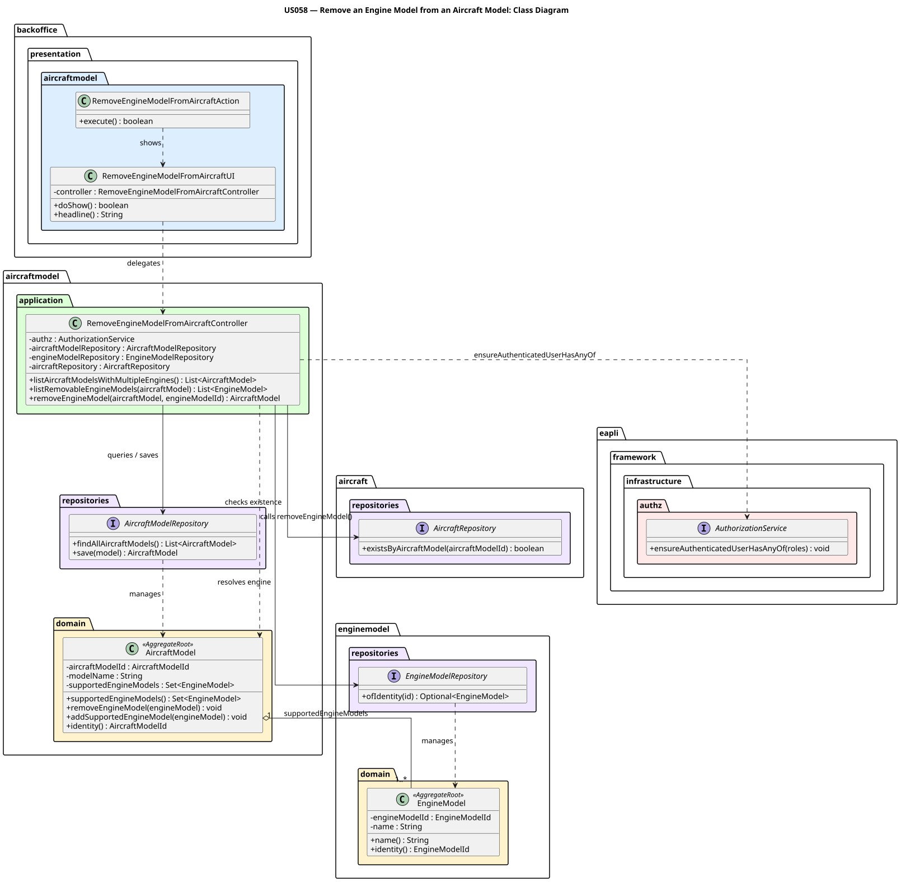
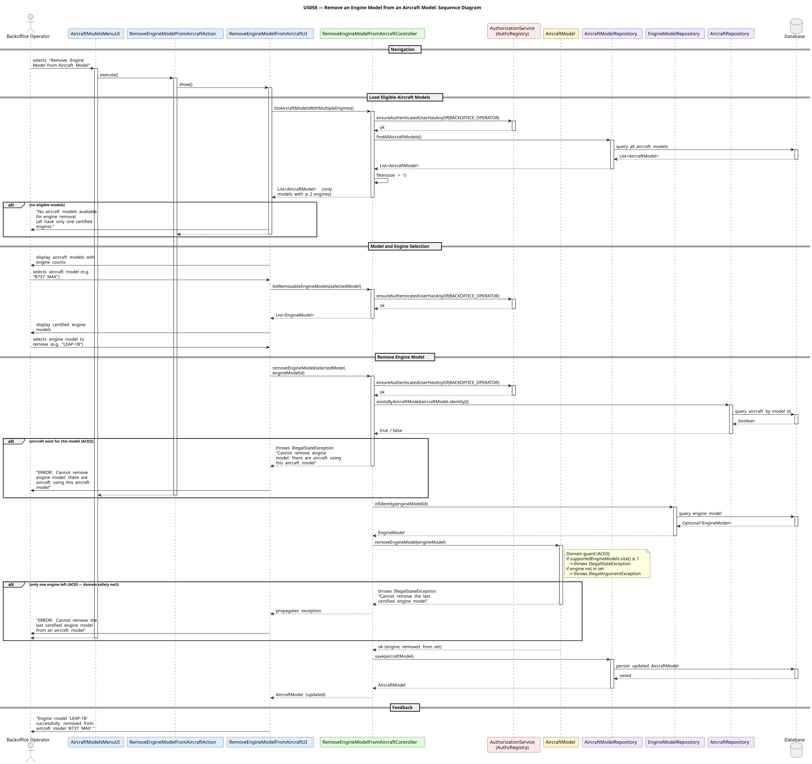

# US058 — Remove an Engine Model from an Aircraft Model

## User Story

> As a **Backoffice Operator**, I want to remove an engine model from an aircraft model's list of certified engines, so that outdated or incompatible engine configurations are no longer available for that aircraft model.

---

## Acceptance Criteria

| # | Criterion |
|---|-----------|
| AC01 | Only an authenticated **Backoffice Operator** may perform this operation. |
| AC02 | The removal is only possible if no actual aircraft are currently using that aircraft model — removing an engine from a model that has registered aircraft is not permitted. |
| AC03 | An aircraft model must always retain at least one certified engine model — removing the last one is not permitted. |
| AC04 | The system must clearly explain why the removal cannot proceed (existing aircraft using the model, or last certified engine). |
| AC05 | After a successful removal, the engine model no longer appears in the aircraft model's certified engine list. |

---

## Implementation Overview

| Module | Role |
|--------|------|
| `aisafe.app.backoffice.console` | Interactive console UI (`RemoveEngineModelFromAircraftUI`, `RemoveEngineModelFromAircraftAction`) |
| `aisafe.core` | Application controller (`RemoveEngineModelFromAircraftController`) and domain model (`AircraftModel`) |

---

## Class Diagram

---

## Sequence Diagram — Remove Engine Model (Console)

---

## User Interaction Flow

1. Backoffice Operator navigates to **Remove Engine Model from Aircraft Model** from the menu.
2. The controller pre-filters the aircraft model list — only models with **more than one** certified engine are shown (enforcing AC03 at the UI level).
3. If no eligible models exist, the console prints `No aircraft models available for engine removal (all have only one certified engine).`
4. The Backoffice Operator selects the aircraft model and then the specific engine model to remove.
5. `RemoveEngineModelFromAircraftController` enforces the `BACKOFFICE_OPERATOR` role (AC01).
6. The controller checks whether any aircraft are registered for the selected aircraft model via `AircraftRepository.existsByAircraftModel(...)` — if so, the operation is rejected (AC02).
7. The domain method `AircraftModel.removeEngineModel(engineModel)` applies a second safety check: if the model has only one engine left, it throws `IllegalStateException` (AC03 domain guard).
8. On success, the updated `AircraftModel` is persisted and the console prints:
   `Engine model '<name>' successfully removed from aircraft model '<name>'.`

---

## Guard Layers

Two independent guards enforce AC02 and AC03:

| Guard | Layer | Trigger |
|-------|-------|---------|
| `aircraftRepository.existsByAircraftModel(id)` | Controller | Any aircraft is registered for this aircraft model |
| `AircraftModel.removeEngineModel()` size check | Domain | Attempting to remove when only 1 engine remains |

The UI additionally pre-filters the model list to only show aircraft models with ≥ 2 engines, preventing the user from ever selecting a single-engine model.

---

## Key Classes

| Class | Location | Responsibility |
|-------|----------|----------------|
| `RemoveEngineModelFromAircraftUI` | `backoffice.presentation.aircraftmodel` | Console form — lists eligible models and engines; delegates to controller |
| `RemoveEngineModelFromAircraftAction` | `backoffice.presentation.aircraftmodel` | Menu action wiring — instantiates and shows `RemoveEngineModelFromAircraftUI` |
| `RemoveEngineModelFromAircraftController` | `aircraftmodel.application` | Enforces `BACKOFFICE_OPERATOR` authorization; checks for existing aircraft; invokes domain removal; persists |
| `AircraftModel` | `aircraftmodel.domain` | Aggregate root — owns `removeEngineModel()`, which enforces the "at least one engine" invariant |
| `AircraftModelRepository` | `aircraftmodel.repositories` | Provides `findAllAircraftModels()` and `save()` |
| `AircraftRepository` | `aircraft.repositories` | Provides `existsByAircraftModel(AircraftModelId)` — used to guard AC02 |
| `EngineModelRepository` | `enginemodel.repositories` | Resolves `EngineModelId` to a domain `EngineModel` object |
