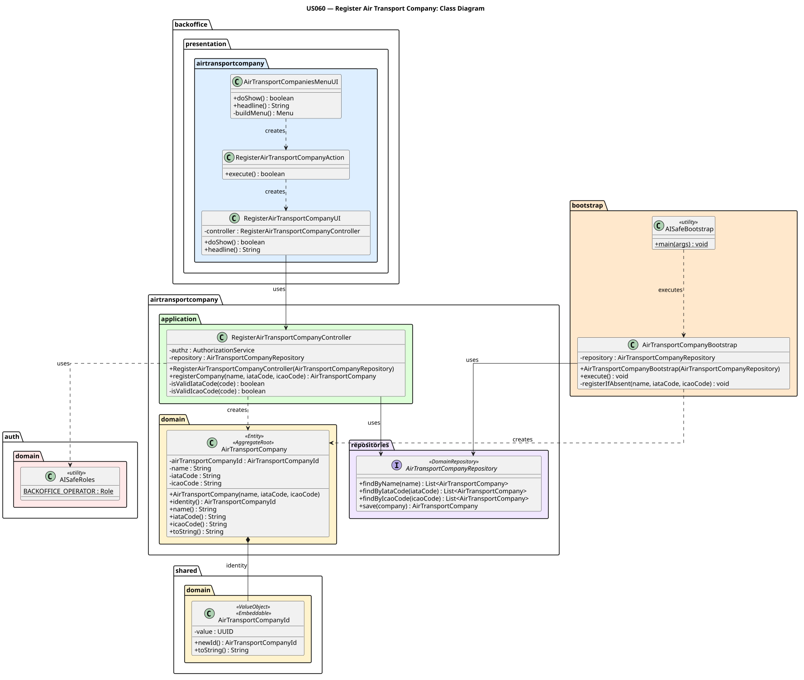

# US060 — Register Air Transport Company

## User Story

> As a **Backoffice Operator**, I want to register an air transport company.
> A company has a company name, an IATA code (2 letters) and ICAO code (2–3 letters) that must be unique.
> This must also be achievable by a bootstrap process.

---

## Acceptance Criteria

| # | Criterion |
|---|-----------|
| AC1 | Only an authenticated **Backoffice Operator** may register a company. |
| AC2 | IATA code must be exactly **2 letters** (A–Z). |
| AC3 | ICAO code must be **2–3 letters** (A–Z). |
| AC4 | Company name must be non-empty. |
| AC5 | IATA and ICAO codes must each be **unique** — duplicate codes are rejected. |
| AC6 | The bootstrap process registers seed companies if they do not already exist (idempotent). |

---

## Implementation Overview

| Module | Role |
|--------|------|
| `aisafe.app.backoffice.console` | Interactive console UI (`RegisterAirTransportCompanyUI`, `RegisterAirTransportCompanyAction`) |
| `aisafe.core` | Application controller (`RegisterAirTransportCompanyController`) and domain model (`AirTransportCompany`) |
| `aisafe.app.bootstrap` | Seed data (`AirTransportCompanyBootstrap`, `AISafeBootstrap`) |

---

## Class Diagram



---

## Sequence Diagram — Manual Registration (Console)


---

## User Interaction Flow

1. Backoffice Operator navigates to **Register Air Transport Company** from the menu.
2. The console prompts for:
   - Company name (e.g. `TAP Air Portugal`)
   - IATA code — exactly 2 letters (e.g. `TP`)
   - ICAO code — 2–3 letters (e.g. `TAP`)
3. `RegisterAirTransportCompanyController` verifies the caller has the `BACKOFFICE_OPERATOR` role.
4. The controller validates IATA and ICAO format, then checks uniqueness against the repository.
5. A new `AirTransportCompany` is created (with a generated `AirTransportCompanyId`) and saved.
6. The console prints `Air Transport Company registered successfully.`

---

## Bootstrap Process

`AISafeBootstrap.main()` calls `AirTransportCompanyBootstrap.execute()`, which seeds the following companies if they do not already exist:

| Company | IATA | ICAO |
|---------|------|------|
| TAP Air Portugal | TP | TAP |
| RyanAir | FR | RYR |
| EasyJet | U2 | EZY |
| Lufthansa | LH | DLH |
| Air France | AF | AFR |
| British Airways | BA | BAW |
| KLM Royal Dutch Airlines | KL | KLM |
| Iberia | IB | IBE |
| Alitalia | AZ | AZA |
| Swiss International Airlines | LX | SWR |

Uniqueness is checked by IATA and ICAO before each insert — re-running bootstrap does not create duplicates.

---

## Key Classes

| Class | Location | Responsibility |
|-------|----------|----------------|
| `RegisterAirTransportCompanyUI` | `backoffice.presentation.airtransportcompany` | Console form — collects name, IATA, ICAO and delegates to controller |
| `RegisterAirTransportCompanyAction` | `backoffice.presentation.airtransportcompany` | Menu action wiring — instantiates and shows `RegisterAirTransportCompanyUI` |
| `RegisterAirTransportCompanyController` | `airtransportcompany.application` | Enforces BACKOFFICE_OPERATOR authorization, validates codes, checks uniqueness, persists |
| `AirTransportCompany` | `airtransportcompany.domain` | Aggregate root — holds name, IATA code, ICAO code and a generated identity |
| `AirTransportCompanyId` | `shared.domain` | UUID-based value object used as the aggregate identity |
| `AirTransportCompanyRepository` | `airtransportcompany.repositories` | Domain repository — `findByIataCode`, `findByIcaoCode`, `save` |
| `AirTransportCompanyBootstrap` | `bootstrap` | Seeds 10 default companies on first run; idempotent |
| `AISafeBootstrap` | `bootstrap` | Application bootstrap entry point — orchestrates all seed data loaders |

---

## EAPLI Theoretical Principles — Practical Application

### Domain-Driven Design (DDD)

- **Ubiquitous Language**: "Air Transport Company," "IATA Code," "ICAO Code" form the shared language of airline management.
- **Bounded Context**: Company Registration is a separate bounded context from aircraft and flight management.
- **Aggregate Root**: `AirTransportCompany` is the aggregate root — manages company identity (name, IATA, ICAO codes).
- **Value Objects**: `IataCode` (exactly 2 letters, immutable), `IcaoCode` (2–3 letters, immutable), `CompanyName` (non-empty string, immutable) encapsulate validation.
- **Repository Pattern**: `AirTransportCompanyRepository` abstracts persistence and supports uniqueness queries by IATA and ICAO.

### Gang of Four Design Patterns

| Pattern | Application | Benefit |
|---------|------------|---------|
| **Factory** | `AirTransportCompanyFactory` validates and creates company with correct code format | Prevents invalid codes from being persisted |
| **Repository** | `AirTransportCompanyRepository` provides queries by IATA and ICAO codes | Decouples domain from SQL queries |
| **Value Object** | `IataCode`, `IcaoCode` encapsulate validation rules | Ensures only valid codes can be created |
| **DTO** | `AirTransportCompanyDTO` carries company data across layers | Safe field exposure |

### SOLID Principles

- **Single Responsibility Principle (SRP)**: `AirTransportCompany` manages company state; `AirTransportCompanyRepository` handles persistence; `RegisterAirTransportCompanyController` orchestrates registration.
- **Open/Closed Principle (OCP)**: Adding new code formats (e.g., 3-letter IATA) extends `IataCode` without changing existing code.
- **Liskov Substitution Principle (LSP)**: Any `AirTransportCompanyRepository` implementation (JPA, in-memory) can replace another without breaking queries.
- **Interface Segregation Principle (ISP)**: `AirTransportCompanyRepository` exposes only needed methods (`findByIataCode()`, `findByIcaoCode()`, `save()`).
- **Dependency Inversion Principle (DIP)**: Controller depends on `AirTransportCompanyRepository` abstraction, not concrete implementations.

### Immutable Value Objects for Codes

```java
// IataCode validates during construction — invalid codes cannot exist
IataCode iata = IataCode.of("TP");        // 2 letters: valid ✓
IataCode iata = IataCode.of("INVALID");   // >2 letters: throws DomainException ✗

// Once created, codes are immutable — no risk of modification
public final class IataCode {
    private final String code;
    
    private IataCode(String code) {
        validate(code);  // Throws if invalid
        this.code = code;
    }
}
```

This ensures the domain model can never contain invalid codes, eliminating validation at persistence layer.

### Data Transfer Objects (DTOs)

- **AirTransportCompanyDTO**: Name, IATA code, ICAO code for display — never exposes internal state.
- **Benefit**: Changing internal representation (e.g., storing codes as enums) doesn't affect presentation layer.

### Bootstrap Idempotency Pattern

The bootstrap process uses unique code checks to ensure idempotency:

```java
for (AirTransportCompany company : seedCompanies) {
    if (! repository.existsByIataCode(company.iataCode())) {
        repository.save(company);
    }
}
```

This allows re-running the bootstrap multiple times without creating duplicates.
