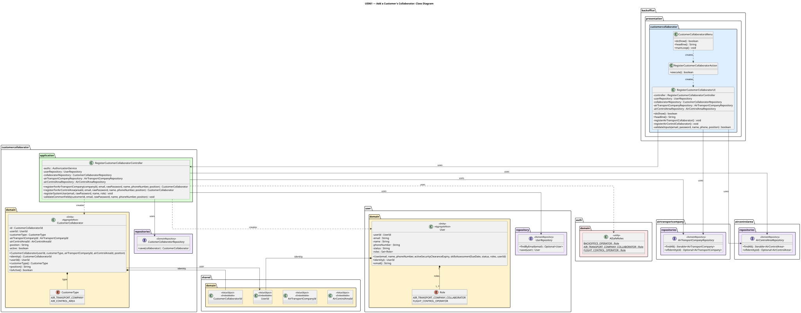

# US061 — Register Customer Collaborator

## User Story

> As a **Backoffice Operator**, I want to register a customer's collaborator. A customer may be an air transport company or an air control area. The collaborator will also be a user of the system. Each collaborator will be a distinct system user. This must also be achievable by a bootstrap process.

---

## Acceptance Criteria

| # | Criterion |
|---|-----------|
| AC01 | Only an authenticated **Backoffice Operator** can register a collaborator |
| AC02 | Collaborator must be associated with an existing customer (air transport company or air control area) |
| AC03 | Required fields: email, name, position |
| AC04 | Each collaborator must have a unique email across all system users |
| AC05 | Collaborator is simultaneously created as a system user with an appropriate role |
| AC06 | No requirement to validate collaborator email domain belongs to customer |
| AC07 | Duplicate email registration is rejected with a meaningful error |
| AC08 | Bootstrap process can pre-load collaborators on system startup |

---

## Implementation Overview

| Module | Role |
|--------|------|
| `aisafe.app.backoffice.console` | Console UI for registering collaborators (`RegisterCollaboratorUI`) |
| `aisafe.core` | Controller (`RegisterCollaboratorController`) and domain model (`Collaborator`, `SystemUser`) |
| `aisafe.app.bootstrap` | Seed loader for collaborators (`CollaboratorBootstrap`) |

---

## EAPLI Theoretical Principles — Practical Application

### Domain-Driven Design (DDD)

- Use a ubiquitous language for domain concepts (`Collaborator`, `Customer`, `User`).
- `Collaborator` is an aggregate that coordinates `User` creation in the application layer.

### Gang of Four (GoF) Patterns

| Pattern | Location | Purpose |
|--------|---------|--------|
| **Repository** | `CustomerCollaboratorRepository` | Abstracts persistence and uniqueness checks.

### SOLID Principles

1. **Single Responsibility Principle (SRP)**
   - Separate UI, controller, repository, domain, and bootstrap responsibilities.

2. **Open/Closed Principle (OCP)**
   - Extend collaborator validation, role assignment, or bootstrap sources without changing the existing registration flow.

3. **Liskov Substitution Principle (LSP)**
   - Repository implementations should be interchangeable for tests and production without affecting collaborator creation semantics.

4. **Interface Segregation Principle (ISP)**
   - Use small, focused interfaces for registration and lookup instead of a single large repository contract.

5. **Dependency Inversion Principle (DIP)**
   - Controllers depend on abstractions such as repositories, factory services, and authorization services.

## Class Diagram

---

## Sequence Diagram — Manual Registration (Console)

---

## User Interaction Flow

1. Backoffice Operator opens **Register Collaborator**.
2. Console prompts for: customer id (company or air control area), collaborator name, email, position, (optional phone).
3. Controller authorizes action and validates required fields and email format.
4. Controller checks that the referenced customer exists and that the email is unique among system users.
5. If valid, create `Collaborator` linked to the customer and create corresponding `SystemUser` account with appropriate role; return success.

---

## Bootstrap Process

`CollaboratorBootstrap` loads pre-configured collaborators and creates both collaborator records and system users if they do not exist. Idempotency is ensured by checking user email and collaborator existence.

---

## Key Classes

| Class | Location | Responsibility |
|-------|----------|----------------|
| `RegisterCollaboratorUI` | `backoffice.presentation.collaborator` | UI to collect collaborator details |
| `RegisterCollaboratorController` | `collaborator.application` | Authorization, validation, association to customer, user creation |
| `Collaborator` | `collaborator.domain` | Domain entity: name, email, position, associated customer, active/disabled flag |
| `User` | `user.domain` | Represents authentication user with roles; created alongside collaborator |
| `CustomerCollaboratorRepository` | `customercollaborator.repositories` | Persistence operations; queries by customer and email |

---

## Domain Notes

- Email uniqueness must be enforced across all users — repository-level unique constraint recommended.
- Collaborator creation must also create a `User` entry with proper role (e.g., `AIR_TRANSPORT_COMPANY_COLLABORATOR`).
- Bootstrap process must be idempotent and safe to re-run.

