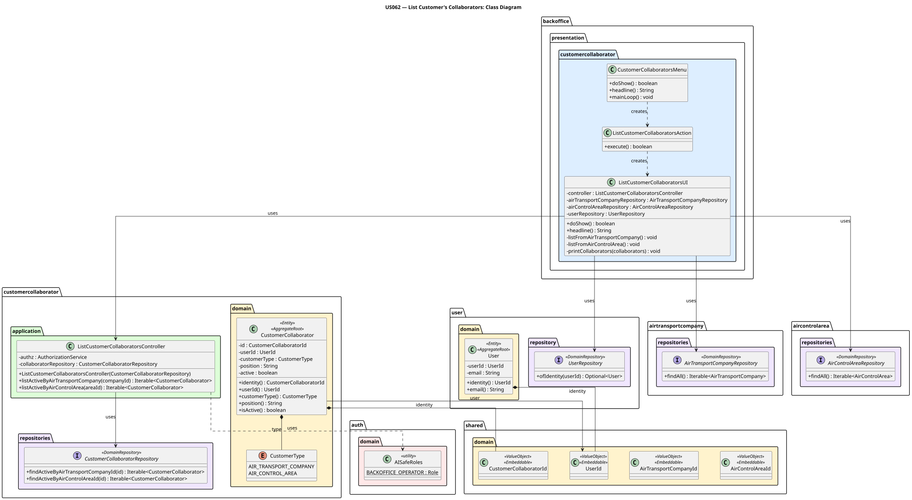

# US062 — List Customer's Collaborators

## User Story

> As a **Backoffice Operator**, I want to list all collaborators of a given customer. It should not list disabled collaborators.

---

## Acceptance Criteria

| # | Criterion |
|---|-----------|
| AC01 | Only an authenticated **Backoffice Operator** can list collaborators |
| AC02 | The list must be filtered by a specific customer (air transport company or air control area) |
| AC03 | Disabled collaborators must not appear in the list |
| AC04 | Each entry displays at minimum: name, email, and position |
| AC05 | If a customer has no active collaborators, show appropriate empty state |
| AC06 | The list reflects real-time status (recently disabled collaborators are excluded) |

---

## Implementation Overview

| Module | Role |
|--------|------|
| `aisafe.app.backoffice.console` | UI to request and display collaborator lists (`ListCollaboratorsUI`) |
| `aisafe.core` | Application controller (`ListCollaboratorsController`) and domain (`Collaborator`) |

---

## EAPLI Theoretical Principles — Practical Application

### Domain-Driven Design (DDD)

- `Collaborator` and `Customer` are core domain concepts; `Collaborator` is an entity with an `active` flag.
- Queries for active collaborators are implemented in repositories and reflect domain invariants.

### Gang of Four (GoF) Patterns

| Pattern | Location | Purpose |
|--------|---------|--------|
| **Repository** | `CollaboratorRepository` | Encapsulates queries such as `findActiveByCustomer`.
| **DTO** | `CollaboratorSummaryDTO` | Represents collaborator rows returned to the UI.

### SOLID Principles

1. **Single Responsibility Principle (SRP)**
   - Separate query logic from presentation and keep the controller focused on orchestration.

2. **Open/Closed Principle (OCP)**
   - Add new filters or sorting strategies without changing the current list workflow.

3. **Liskov Substitution Principle (LSP)**
   - Any `CollaboratorRepository` implementation should return the same contract for active collaborator queries.

4. **Interface Segregation Principle (ISP)**
   - Expose a small repository interface for listing active collaborators instead of a broad CRUD interface.

5. **Dependency Inversion Principle (DIP)**
   - Controllers depend on repository abstractions and DTOs rather than concrete persistence details.

## Class Diagram

---

## Sequence Diagram — Fetching Collaborators

---

## User Interaction Flow

1. Backoffice Operator selects **List Collaborators**.
2. UI prompts for customer id (company or air control area).
3. Controller authorizes caller and queries `CollaboratorRepository.findActiveByCustomer(customerId)`.
4. Results are displayed with name, email, position per entry. If empty, show a friendly empty-state message.

---

## Data & Real-time Considerations

- Only collaborators with `active = true` are returned.
- If immediate consistency is required after disabling a collaborator, ensure the disable operation updates the same repository used by this query (transactional commit before read).

---

## Key Classes

| Class | Location | Responsibility |
|-------|----------|----------------|
| `ListCollaboratorsUI` | `backoffice.presentation.collaborator` | Prompts for customer and displays active collaborators |
| `ListCollaboratorsController` | `collaborator.application` | Authorization, loads active collaborators from repository |
| `CollaboratorRepository` | `collaborator.repositories` | `findActiveByCustomer(customerId)` — returns non-disabled collaborators |

---

## Edge Cases

- Non-existent customer -> return a clear error message.
- If repository returns no active collaborators, display empty-state text.

