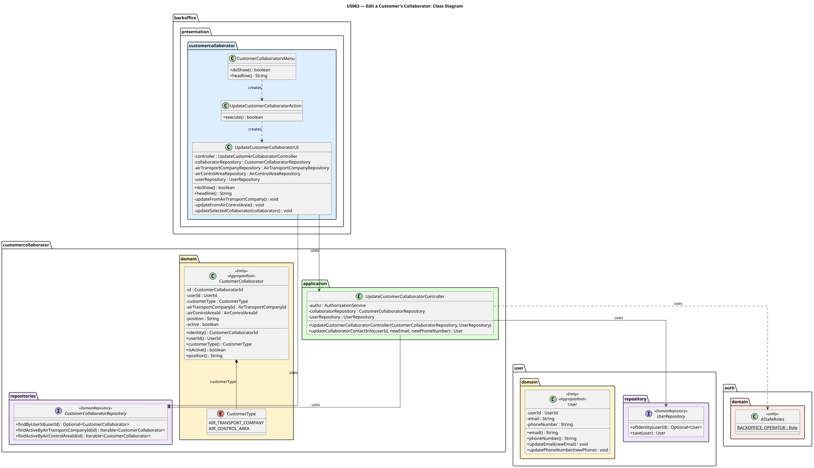

# US063 — Edit Collaborator Contact Information

## User Story

> As a **Backoffice Operator**, I want to edit the information (email and phone number) of a customer's collaborator, so that their contact details are kept up to date in the system.

---

## Acceptance Criteria

| # | Criterion |
|---|-----------|
| AC01 | Only an authenticated **Backoffice Operator** can edit collaborator information |
| AC02 | Only the email and phone number may be edited — other fields cannot be changed by this operation |
| AC03 | New email must be in a valid email format |
| AC04 | New phone number must be in a valid format |
| AC05 | System confirms the update was successful |
| AC06 | If collaborator does not exist or is disabled, reject with clear error |

---

## Implementation Overview

| Module | Role |
|--------|------|
| `aisafe.app.backoffice.console` | UI allowing input of new email/phone (`EditCollaboratorUI`) |
| `aisafe.core` | Controller (`EditCollaboratorController`), domain (`Collaborator`) |

---

## EAPLI Theoretical Principles — Practical Application

### Domain-Driven Design (DDD)

- Keep `Collaborator` as the aggregate; only contact information is mutable by this use case.
- Validation of email and phone formats is responsibility of the application/controller layer before invoking domain updates.

### Gang of Four (GoF) Patterns

| Pattern | Location | Purpose |
|--------|---------|--------|
| **Repository** | `CollaboratorRepository` | `findById`, `save` abstractions for persistence.
| **DTO** | `EditCollaboratorContactRequest` | Carries contact updates from UI to controller.

### SOLID Principles

1. **Single Responsibility Principle (SRP)**
   - Editing contact info is handled by a dedicated controller/service boundary, keeping responsibilities narrow.

2. **Open/Closed Principle (OCP)**
   - Additional editable contact fields can be introduced with extensions rather than rewriting the existing flow.

3. **Liskov Substitution Principle (LSP)**
   - Any collaborator persistence implementation should be substitutable without changing the update behavior.

4. **Interface Segregation Principle (ISP)**
   - Prefer small interfaces for editing contact data rather than a large all-purpose collaborator interface.

5. **Dependency Inversion Principle (DIP)**
   - The controller depends on abstractions such as repository interfaces and validation services.

## Class Diagram

---

## Sequence Diagram — Edit Contact Info

---

## User Interaction Flow

1. Backoffice Operator selects **Edit Collaborator Contact**.
2. UI prompts for collaborator id and new email and/or new phone number.
3. Controller authorizes caller and validates collaborator exists and is active.
4. Controller validates email and phone formats; ignores any changes to non-editable fields.
5. On success, repository updates collaborator contact fields and returns confirmation.

---

## Key Classes

| Class | Location | Responsibility |
|-------|----------|----------------|
| `EditCollaboratorUI` | `backoffice.presentation.collaborator` | Collects collaborator id and new contact info |
| `EditCollaboratorController` | `collaborator.application` | Authorization, validation, and updating contact fields |
| `CollaboratorRepository` | `collaborator.repositories` | `findById`, `save` |

---

## Validation Notes

- Email: use a robust regex or existing validation utility rather than naive checks.
- Phone: define an acceptable format (E.164 recommended) and validate accordingly.
- Only update email/phone; reject or ignore attempts to modify other fields.

