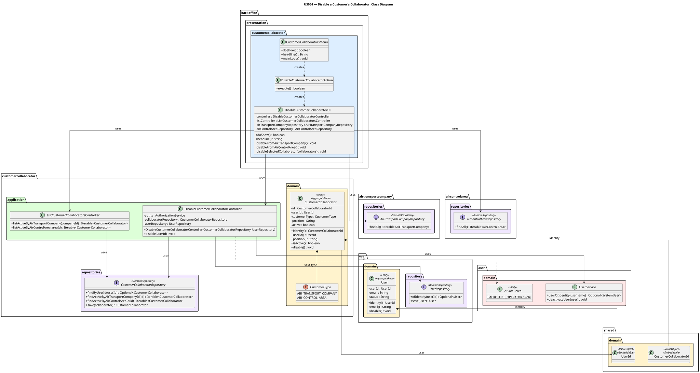

# US064 — Disable Collaborator

## User Story

> As a **Backoffice Operator**, I want to disable a customer's collaborator so that he may not use the system anymore.

---

## Acceptance Criteria

| # | Criterion |
|---|-----------|
| AC01 | Only an authenticated **Backoffice Operator** can disable a collaborator |
| AC02 | The collaborator must exist and be currently active |
| AC03 | A disabled collaborator cannot log into the system |
| AC04 | Disabling preserves collaborator data (no deletion) |
| AC05 | Disabled collaborators no longer appear in active lists (US062) |
| AC06 | Attempting to disable an already disabled collaborator is rejected with a meaningful error |

---

## Implementation Overview

| Module | Role |
|--------|------|
| `aisafe.app.backoffice.console` | UI for disabling collaborators (`DisableCustomerCollaboratorUI`) |
| `aisafe.core` | Controller (`DisableCustomerCollaboratorController`), domain (`CustomerCollaborator`) |

---

## EAPLI Theoretical Principles — Practical Application

### Domain-Driven Design (DDD)

- Disabling a collaborator is a domain operation that toggles an `active` flag; it is modeled as a state change, not deletion.

### Gang of Four (GoF) Patterns

| Pattern | Location | Purpose |
|--------|---------|--------|
| **Repository** | `CustomerCollaboratorRepository` | Persists `active` state and provides queries filtering active collaborators.
| **Adapter** | Authentication component | Reads `active` flag to deny login for disabled users.

### SOLID Principles

1. **Single Responsibility Principle (SRP)**
   - Separate disable logic from other update operations; `DisableCustomerCollaboratorController` and `CustomerCollaborator` each have one responsibility.

2. **Open/Closed Principle (OCP)**
   - New policies for disabling collaborators (e.g., additional business rules) should be added via extension without modifying existing tested code.

3. **Liskov Substitution Principle (LSP)**
   - Repository or service implementations used by the controller can be substituted (e.g., in-memory for tests) without changing behavior.

4. **Interface Segregation Principle (ISP)**
   - Prefer small, focused interfaces (e.g., a `CollaboratorDisabling` interface) rather than a fat repository interface.

5. **Dependency Inversion Principle (DIP)**
   - Controllers depend on abstractions (repositories, authorization services) instead of concrete implementations, enabling easier testing and inversion of control.

## Class Diagram

---

## Sequence Diagram — Disable Collaborator

---

## User Interaction Flow

1. Backoffice Operator selects **Disable Collaborator**.
2. UI prompts for collaborator id.
3. Controller authorizes caller and checks collaborator exists and active status.
4. If active, set `active=false` (or `disabled=true`) and persist; do not delete records.
5. Return confirmation; subsequent authentication attempts for that user fail.

---

## Key Classes

| Class | Location | Responsibility |
|-------|----------|----------------|
| `DisableCustomerCollaboratorUI` | `backoffice.presentation.customercollaborator` | Prompts for collaborator id to disable |
| `DisableCustomerCollaboratorController` | `customercollaborator.application` | Authorization and disabling logic |
| `CustomerCollaboratorRepository` | `customercollaborator.repositories` | `findById`, `save` |

---

## Security & Persistence Notes

- Authentication component must check collaborator `active` flag and reject login for disabled users.
- Prefer soft-disable approach (flag) to preserve history; do not remove user credentials unless explicitly requested elsewhere.

