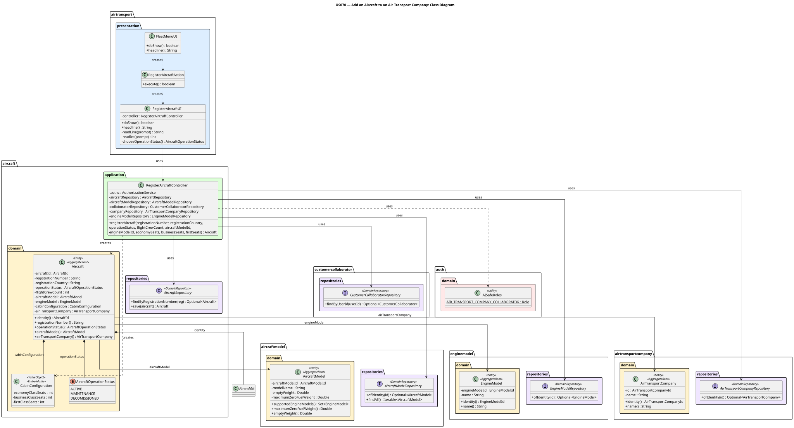
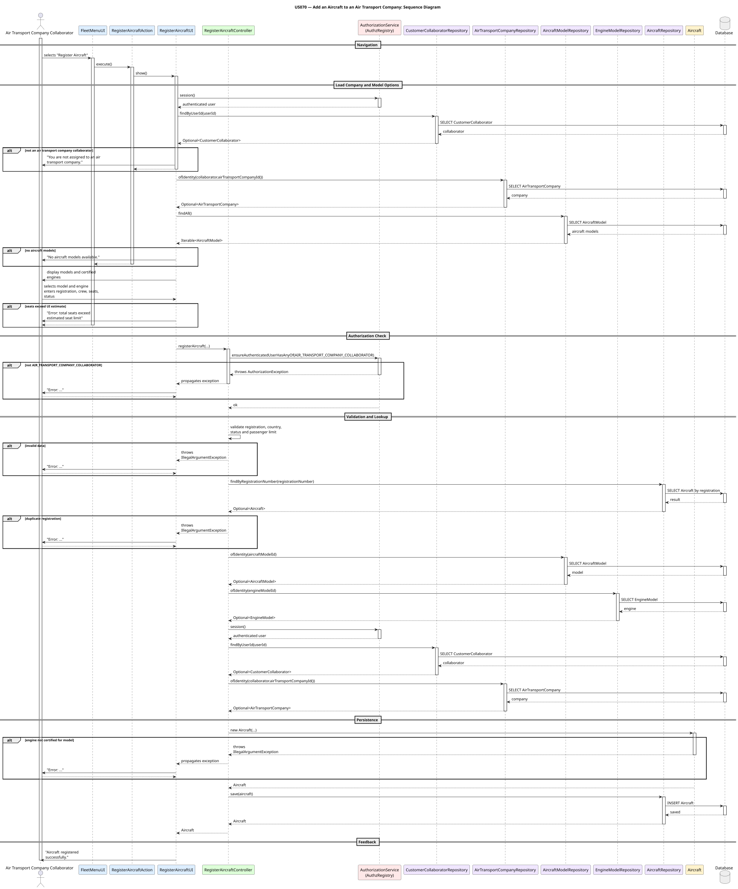

# US070 — Add Aircraft to Fleet

## User Story

> As an **Air Transport Company Collaborator (ATCC)**, I want to add an aircraft to my company's fleet. The aircraft is of a given model, including the engines, and the number of seats of each type/class must be provided. Total number of seats cannot exceed the model's capacity. An aircraft is identified by the aircraft registration number, that is unique. An aircraft also has an operational status.

---

## Acceptance Criteria

| # | Criterion |
|---|-----------|
| AC01 | Only an authenticated **ATCC** can add an aircraft to their company's fleet |
| AC02 | The aircraft must be associated with an existing aircraft model |
| AC03 | The aircraft registration number must be unique across the system |
| AC04 | Total seats across all classes must not exceed the model's capacity |
| AC05 | Country of registration must be provided |
| AC06 | Aircraft must be assigned an operational status on creation |
| AC07 | Duplicate registration number is rejected |
| AC08 | Seats exceeding model capacity are rejected |

---

## Implementation Overview

| Module | Role |
|--------|------|
| `aisafe.app.airtransport.console` | Console UI (`AddAircraftUI`) |
| `aisafe.core` | Controller (`AddAircraftController`), domain (`Aircraft`, `AircraftModel`) |

---

## EAPLI Theoretical Principles — Practical Application

### Domain-Driven Design (DDD)

- `Aircraft` is an aggregate with invariants (registration uniqueness, seat capacity constraints).
- Use value objects for `RegistrationNumber` and `SeatConfiguration` to encapsulate validation.

### Gang of Four (GoF) Patterns

| Pattern | Location | Purpose |
|--------|---------|--------|
| **Factory** | `AircraftFactory` | Creates `Aircraft` aggregates with validated seat configuration.
| **Repository** | `AircraftRepository` | Persistence abstraction; enforces registration uniqueness.
| **DTO** | `AddAircraftRequest` | Transfers aircraft creation data from UI to controller.

### SOLID Principles

1. **Single Responsibility Principle (SRP)**
   - UI, controller, domain, and repository each have a clear and narrow responsibility.

2. **Open/Closed Principle (OCP)**
   - New cabin configurations, seat classes, or validation rules can be added without rewriting the use case.

3. **Liskov Substitution Principle (LSP)**
   - Different `AircraftRepository` implementations should be interchangeable for tests and production.

4. **Interface Segregation Principle (ISP)**
   - Prefer focused interfaces for aircraft creation and lookup rather than one broad persistence interface.

5. **Dependency Inversion Principle (DIP)**
   - Controllers depend on abstractions such as repository and authorization interfaces, not concrete classes.

## Class Diagram

---

## Sequence Diagram — Add Aircraft

---

## User Interaction Flow

1. ATCC selects **Add Aircraft to Fleet**.
2. UI collects: registration number, aircraft model id, engines config, seats per class, country of registration, initial operational status.
3. Controller authorizes user belongs to the company, validates model exists and registration uniqueness, verifies seats sum ≤ model capacity.
4. On success, create `Aircraft` entity and persist; report success.

---

## Key Classes

| Class | Location | Responsibility |
|-------|----------|----------------|
| `AddAircraftUI` | `airtransport.presentation.aircraft` | Collects aircraft data from ATCC |
| `AddAircraftController` | `airtransport.application` | Authorization, validation, associates aircraft with company, persists |
| `Aircraft` | `airtransport.domain` | Aggregate — registration, model, cabin configuration, country, status |
| `AircraftRepository` | `airtransport.repositories` | `findByRegistration`, `save` |

---

## Domain Notes

- Enforce registration uniqueness at repository/database level.
- Cabin configuration should be validated against the `AircraftModel` capacity.
- Operational status is an enum (e.g., ACTIVE, MAINTENANCE, RETIRED) with initial state required on create.

