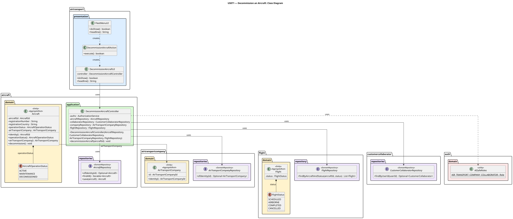
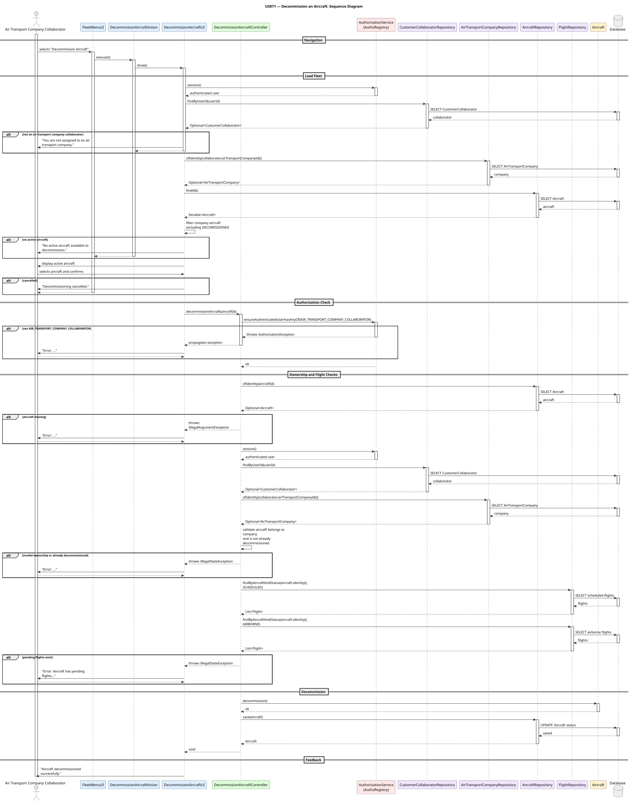

# US071 — Retire / Decommission Aircraft

## User Story

> As an **Air Transport Company Collaborator (ATCC)**, I want to retire an aircraft from my company's fleet. It's not possible to create flights for a retired aircraft, nor is it possible to retire an aircraft that has pending flights registered in the system.

---

## Acceptance Criteria

| # | Criterion |
|---|-----------|
| AC01 | Only an authenticated **ATCC** can decommission an aircraft from their company |
| AC02 | An aircraft with pending flights cannot be decommissioned |
| AC03 | A decommissioned aircraft cannot be assigned to new flights |
| AC04 | Decommissioning does not delete the aircraft's data from the system |
| AC05 | Aircraft's operational status is updated to `RETIRED` after decommissioning |
| AC06 | Attempting to decommission an already retired aircraft is rejected with a meaningful error |

---

## Implementation Overview

| Module | Role |
|--------|------|
| `aisafe.app.airtransport.console` | Console UI (`DecommissionAircraftUI`) |
| `aisafe.core` | Controller (`DecommissionAircraftController`), domain (`Aircraft`) |

---

## EAPLI Theoretical Principles — Practical Application

### Domain-Driven Design (DDD)

- `Aircraft` aggregate manages operational status; decommissioning is a state transition to `RETIRED`.
- Ensure transactional check-and-update semantics when verifying pending flights and setting `RETIRED`.

### Gang of Four (GoF) Patterns

| Pattern | Location | Purpose |
|--------|---------|--------|
| **Repository** | `AircraftRepository` | Query pending flights and persist status changes.
| **Factory** | `AircraftFactory` (for creation) | Not directly used here, but consistent with creation flows elsewhere.

### SOLID Principles

1. **Single Responsibility Principle (SRP)**
   - The controller checks business conditions while the repository handles persistence and queries.

2. **Open/Closed Principle (OCP)**
   - New aircraft lifecycle rules can be introduced without rewriting the decommission flow.

3. **Liskov Substitution Principle (LSP)**
   - Any `AircraftRepository` or `FlightRepository` implementation should be substitutable without changing outcomes.

4. **Interface Segregation Principle (ISP)**
   - Keep decommissioning-related repository interfaces small and focused on required operations only.

5. **Dependency Inversion Principle (DIP)**
   - Controllers depend on abstractions for aircraft and flight access, enabling test doubles and decoupling.

## Class Diagram

---

## Sequence Diagram — Decommissioning

---

## User Interaction Flow

1. ATCC selects **Decommission Aircraft** and provides aircraft registration.
2. Controller authorizes user and verifies the aircraft belongs to their company.
3. Controller queries for pending flights tied to the aircraft. If any pending flights exist, reject operation with informative error.
4. Otherwise, update aircraft operational status to `RETIRED` (soft state change), persist, and return success.

---

## Key Classes

| Class | Location | Responsibility |
|-------|----------|----------------|
| `DecommissionAircraftUI` | `airtransport.presentation.aircraft` | Prompts for registration to decommission |
| `DecommissionAircraftController` | `airtransport.application` | Authorization, pending flights check, status update |
| `AircraftRepository` | `airtransport.repositories` | `findByRegistration`, `save` |
| `FlightRepository` | `flight.repositories` | Query pending flights by aircraft id |

---

## Domain Notes

- Represent operational status as an enum with a `RETIRED` state.
- Prevent creating new flights for aircraft with status `RETIRED` via domain/application checks.
- Decommissioning must be atomic: check pending flights and update status in the same transactional context to avoid races.

