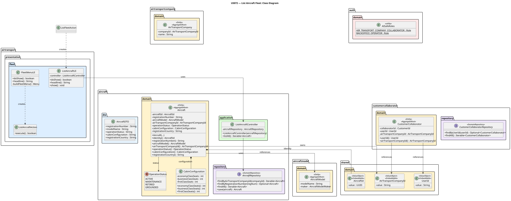
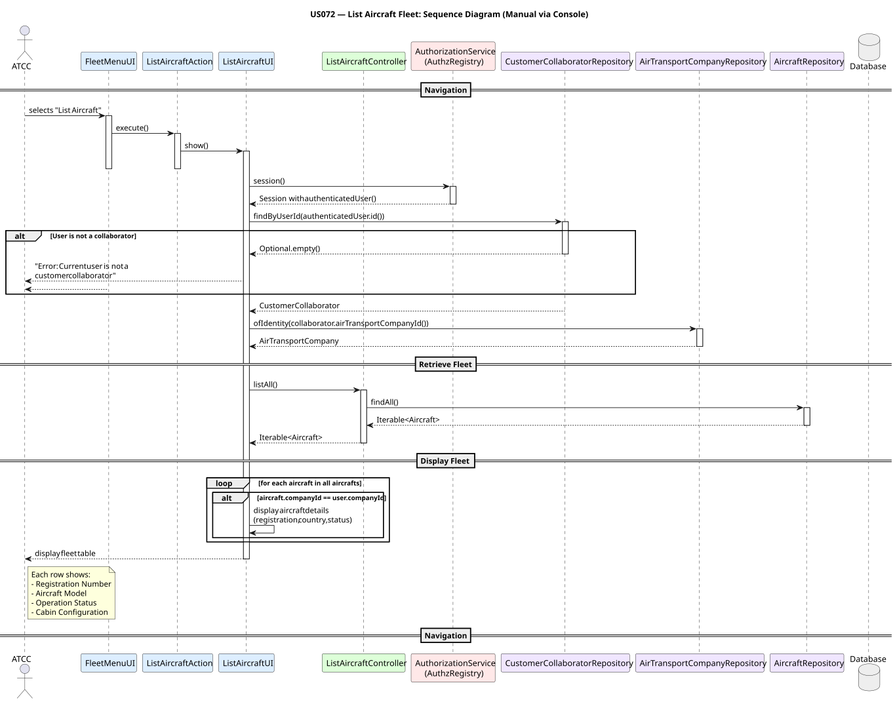

# US072 — List Aircraft Fleet

## User Story

> As an **Air Transport Company Collaborator**, I want to list my company's aircraft fleet.

---

## Acceptance Criteria

| #    | Criteria                                                                                      |
| ---- | --------------------------------------------------------------------------------------------- |
| AC01 | Only an authenticated ATCC can list their company's fleet                                     |
| AC02 | Each entry shows at minimum: registration number, model, operational status, and cabin config |
| AC03 | The list includes all aircraft regardless of operational status                               |
| AC04 | An ATCC cannot view another company's fleet                                                   |
| AC05 | If the company has no aircraft, the system displays an appropriate empty-state message        |

## Class Diagram



---

## Sequence Diagram — List Aircraft Fleet (Console)



---

## EAPLI Theoretical Principles — Practical Application

### Domain-Driven Design (DDD)

The design of US072 follows core DDD principles:

- **Ubiquitous Language**: Domain terminology is kept in the code (`Aircraft`, `AirTransportCompany`, `AircraftStatus`, `CabinConfiguration`, `fleet`).
- **Bounded Context**: Fleet listing belongs to the Air Transport bounded context, separated from backoffice, weather or simulation contexts.
- **Aggregate Root**: `Aircraft` is the aggregate root that contains the data needed to represent each aircraft in the fleet.
- **Value Objects**: `CabinConfiguration` and other supporting types represent descriptive data without identity.
- **Repository Pattern**: `AircraftRepository` and `AirTransportCompanyRepository` isolate persistence and allow querying the fleet by company.

### Gang of Four (GoF) Patterns

| Pattern | Location | Purpose |
|--------|-------|----------|
| **Factory** | `ListFleetController` / presentation assembly | Builds the fleet view from domain data before showing it in the console |
| **Repository** | `AircraftRepository`, `AirTransportCompanyRepository` | Abstracts reading fleet and company data |
| **Strategy** | `AuthorizationService` | Allows varying authorization policy by role without changing listing logic |
| **DTO** | Data shown in the fleet table | Carries only fields required by the UI for presentation |

### SOLID Principles

The US072 architecture respects the five SOLID principles:

1. **Single Responsibility Principle (SRP)**
   - `ListFleetUI`: presents the list in the console
   - `ListFleetController`: coordinates authorization and data retrieval
   - `Aircraft`: represents aircraft state only

2. **Open/Closed Principle (OCP)**
   - New presentation or filtering criteria can be added without changing the base listing contract.

3. **Liskov Substitution Principle (LSP)**
   - Any compatible repository implementation can replace the current one without affecting controller behavior.

4. **Interface Segregation Principle (ISP)**
   - Repositories expose only operations necessary to query aircraft and companies.

5. **Dependency Inversion Principle (DIP)**
   - The controller depends on repository and authorization abstractions, easing testing and maintenance.

### Data Transfer Objects (DTOs)

DTOs help separate domain data from how it is displayed in the console:

- **Presentation DTO**: contains `registration number`, `model`, `status` and `cabin configuration`.
- **Benefit**: avoids exposing the full `Aircraft` entity directly to the UI.
- **Result**: the presentation layer works only with data prepared for viewing.

### Factory Pattern

The Factory pattern appears when preparing the fleet data for presentation:

```java
// Conceptual example assembling data for the fleet table
FleetRow row = FleetRow.of(registrationNumber, modelName, status, cabinConfiguration);
```

Factory responsibilities:
- Build a presentation-ready representation
- Ensure consistency of displayed fields
- Keep UI free from domain transformation logic

---

- **DTO de apresentação**: contém `registration number`, `model`, `status` e `cabin configuration`.
- **Benefício**: evita expor a entidade completa `Aircraft` diretamente à UI.
- **Resultado**: a camada de apresentação trabalha apenas com dados preparados para visualização.

### Factory Pattern

O padrão Factory aparece na preparação da informação da frota para apresentação:

```java
// Exemplo conceptual da montagem dos dados para a tabela da frota
FleetRow row = FleetRow.of(registrationNumber, modelName, status, cabinConfiguration);
```

**Responsabilidades da Factory**:
- Construir uma representação pronta a apresentar
- Garantir consistência dos campos exibidos
- Manter a UI livre de lógica de transformação de domínio

---

## User Interaction Flow

1. Air Transport Company Collaborator (ATCC) logs in and navigates to **List Aircraft Fleet** from the Fleet Management menu.
2. `ListFleetController` verifies the caller has the `AIR_TRANSPORT_COMPANY_COLLABORATOR` role via `AuthorizationService`.
3. The controller retrieves the authenticated user's associated company (via email domain or explicit association).
4. All aircraft registered to that company are retrieved via `AircraftRepository.findByCompany()`.
5. For each aircraft, the system displays:
   - Registration Number (unique identifier)
   - Model Name and Manufacturer
   - Operational Status (active, maintenance, retired, etc.)
   - Cabin Configuration (economy, business, cargo, mixed, etc.)
6. If no aircraft exist, the system displays: `"No aircraft registered for your company."`
7. The list is presented in console table format, sorted by registration number.

---

## Key Classes

| Class | Location | Responsibility |
|-------|----------|----------------|
| `ListFleetUI` | `airtransport.presentation.fleet` | Console form — displays fleet table, handles user navigation |
| `ListFleetAction` | `airtransport.presentation.fleet` | Menu action wiring — instantiates and shows `ListFleetUI` |
| `ListFleetController` | `aircraft.application` | Enforces ATCC authorization, retrieves authenticated user's company, retrieves fleet data |
| `Aircraft` | `aircraft.domain` | Aggregate root — holds registration number, model, status, cabin config, owner company |
| `AircraftStatus` | `aircraft.domain` | Enum: ACTIVE, MAINTENANCE, RETIRED, GROUNDED, etc. |
| `CabinConfiguration` | `aircraft.domain` | Value object or enum describing cabin layout (economy seats, business seats, cargo volume, etc.) |
| `AirTransportCompany` | `company.domain` | Referenced entity — company that owns the aircraft |
| `AircraftRepository` | `aircraft.repository` | Domain repository for querying aircraft by company |
| `AirTransportCompanyRepository` | `company.repository` | Domain repository for querying company details |


## Authorization

- **Allowed Roles**: AIR_TRANSPORT_COMPANY_COLLABORATOR
- **Ownership Check**: ATCC can only view aircraft belonging to their own company
- **Isolation**: Each ATCC automatically sees only their company's fleet; cross-company access is denied with error: `"Access denied. You can only view your company's fleet."`

---

## Data Presentation

### Fleet Table Format

```
╔════════════════╦══════════════════════════╦════════════════════╦════════════════════╗
║ Registration # ║ Model                    ║ Status             ║ Cabin Configuration║
╠════════════════╬══════════════════════════╬════════════════════╬════════════════════╣
║ CS-TPA         ║ Airbus A320 (Airbus)     ║ Active             ║ 180 Economy        ║
║ CS-TPB         ║ Embraer E190 (Embraer)   ║ Active             ║ 118 Economy        ║
║ CS-TPC         ║ Airbus A330 (Airbus)     ║ Maintenance        ║ 375 Mixed          ║
║ CS-TPD         ║ Boeing 737 (Boeing)      ║ Retired            ║ 162 Economy        ║
╚════════════════╩══════════════════════════╩════════════════════╩════════════════════╝
```

### Empty State Message

```
No aircraft registered for your company.
```

---

## Test Cases

### TC01 – Successfully list company fleet
**Given** an authenticated ATCC and a company with multiple aircraft  
**When** they request the fleet list  
**Then** the system returns all aircraft with registration, model, status, and cabin config

### TC02 – Empty fleet message
**Given** a company has no aircraft registered  
**When** the ATCC requests the fleet list  
**Then** the system displays an appropriate empty-state message

### TC03 – Fleet list includes retired aircraft
**Given** a company has both active and retired aircraft  
**When** the ATCC lists the fleet  
**Then** both active and retired aircraft appear with their correct status

### TC04 – ATCC cannot view another company's fleet
**Given** an authenticated ATCC from company A  
**When** they attempt to list the fleet of company B  
**Then** the system denies access with an appropriate error

### TC05 – Non-ATCC cannot list fleet
**Given** an authenticated user with role FCO  
**When** they attempt to list an air transport company's fleet  
**Then** the system denies access with a 403/Forbidden error

---

## Done Concept

- An ATCC can list all aircraft in their company's fleet
- Each entry displays at minimum: registration number, model, operational status, and cabin configuration
- The list includes aircraft regardless of operational status (active or retired)
- Only authenticated ATCCs can view their own company's fleet
- Test coverage of controller and domain packages ≥ 90%
- Code compiles and all tests pass
- Technical documentation updated in the repository (analysis, design, tests) in Markdown format

