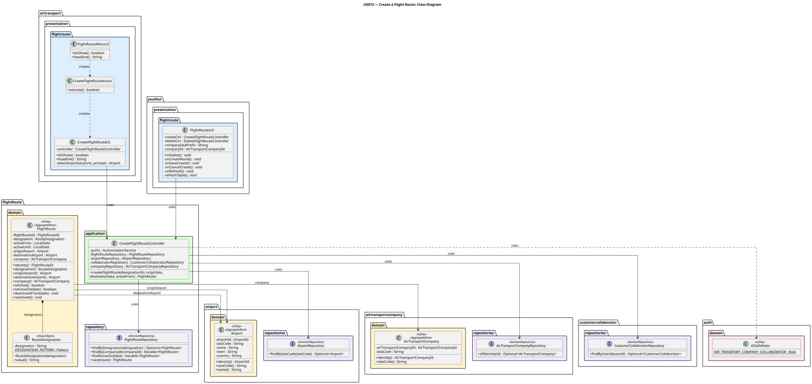

# US073 — Create a Flight Route

## User Story

> As an **Air Transport Company Collaborator (ATCC)**, I want to add a flight route for my company. A route is between two airports (start and end) and has a name with 2 letters (my company's initials) and up to 4 numbers (e.g. TP123). The route's name must be unique.

---

## Acceptance Criteria

| # | Criterion |
|---|-----------|
| AC01 | Only an authenticated **ATCC** can create a flight route |
| AC02 | The route designation must follow the format: 2 uppercase letters (company IATA code) + 1 to 4 digits (e.g. `TP123`) |
| AC03 | The first 2 letters of the designation must match the company's IATA code |
| AC04 | The route designation must be unique across the entire system |
| AC05 | The route must connect two different airports (origin ≠ destination) |
| AC06 | Both airports must exist in the system |
| AC07 | The route is associated with the logged-in collaborator's company |

---

## Implementation Overview

| Module | Role |
|--------|------|
| `aisafe.app.airtransport.console` | Console UI (`CreateFlightRouteUI`, `FlightRouteMenuUI`) |
| `aisafe.app.javafx` | JavaFX UI (`FlightRoutesUI`, `FlightRoutesView.fxml`) |
| `aisafe.core` | Controller (`CreateFlightRouteController`), domain (`FlightRoute`, `RouteDesignation`) |
| `aisafe.persistence.impl` | `JpaFlightRouteRepository`, `InMemoryFlightRouteRepository` |
| `aisafe.app.bootstrap` | `FlightRouteBootstrap` |

---

## EAPLI Theoretical Principles — Practical Application

### Domain-Driven Design (DDD)

- `FlightRoute` is an **Aggregate Root** identified by `FlightRouteId`.
- `RouteDesignation` is a **Value Object** that enforces the naming pattern `^[A-Z]{2}[0-9]{1,4}$`.
- The company IATA prefix constraint is enforced at the **application layer** (controller), since it requires cross-aggregate knowledge of the company.
- `Airport` and `AirTransportCompany` are referenced via `@ManyToOne` relationships from `FlightRoute`.

### Gang of Four (GoF) Patterns

| Pattern | Location | Purpose |
|---------|----------|---------|
| **Repository** | `FlightRouteRepository` | Uniqueness check via `findByDesignation`, persistence via `save` |
| **Value Object** | `RouteDesignation` | Encapsulates and validates the designation format |

### SOLID Principles

1. **Single Responsibility Principle (SRP)** — `RouteDesignation` handles format validation; `CreateFlightRouteController` handles business rules; repositories handle persistence.
2. **Open/Closed Principle (OCP)** — New designation format rules can be added to `RouteDesignation` without changing the controller.
3. **Liskov Substitution Principle (LSP)** — Any `FlightRouteRepository` or `AirportRepository` implementation is substitutable.
4. **Interface Segregation Principle (ISP)** — `FlightRouteRepository` exposes only the operations needed for route management.
5. **Dependency Inversion Principle (DIP)** — The controller depends on repository abstractions, enabling test doubles.

---

## Class Diagram

---

## Sequence Diagram — Create Flight Route

---

## User Interaction Flow

### Console
1. ATCC enters **Flight Route Management → Create Flight Route**.
2. System displays all available airports with numbered list.
3. ATCC selects origin airport by number.
4. ATCC selects destination airport by number.
5. System shows company IATA prefix; ATCC types the numeric suffix.
6. ATCC enters the activation date (optional, defaults to today).
7. Controller validates and persists the route. Confirmation is shown.

### JavaFX
1. ATCC navigates to **Flight Routes** in the sidebar.
2. Clicks **Create Route** — form appears inline.
3. Designation: company prefix is shown as label, ATCC types only the digits.
4. Origin and destination selected via `ComboBox` (all airports listed).
5. Activation date selected via `DatePicker` (defaults to today).
6. Clicks **Save** — table refreshes with new route.

---

## Key Classes

| Class | Location | Responsibility |
|-------|----------|----------------|
| `CreateFlightRouteUI` | `airtransport.presentation.flightroute` | Console form, airport selection by number, prefix auto-fill |
| `FlightRoutesUI` | `javafxui.presentation.flightroute` | JavaFX form with ComboBox airports and DatePicker |
| `CreateFlightRouteController` | `flightRoute.application` | Authorization, prefix check, uniqueness check, creation |
| `FlightRoute` | `flightRoute.domain` | Aggregate root with designation, airports, company, active dates |
| `RouteDesignation` | `flightRoute.domain` | Value Object validating `^[A-Z]{2}[0-9]{1,4}$` |
| `FlightRouteRepository` | `flightRoute.repository` | `findByDesignation`, `findByCompanyId`, `save` |

---

## Domain Notes

- `FlightRoute` stores `activeFrom` (mandatory) and `activeUntil` (null = active).
- A route with `activeUntil = null` is considered active; once deactivated (US074), `activeUntil` is set.
- The `RouteDesignation` value object ensures format correctness at construction time, making invalid designations unrepresentable in the domain.
