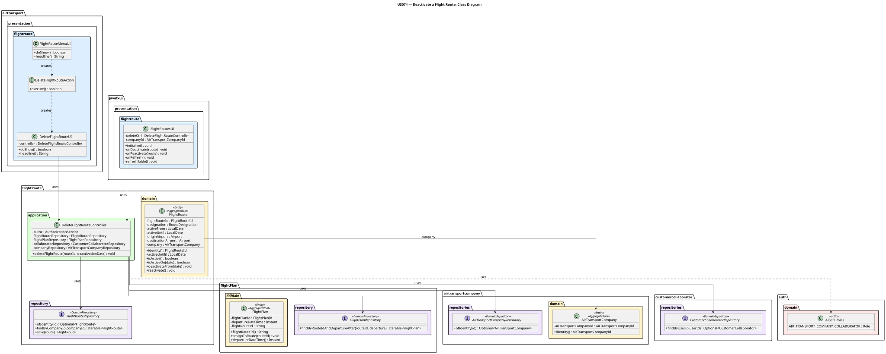
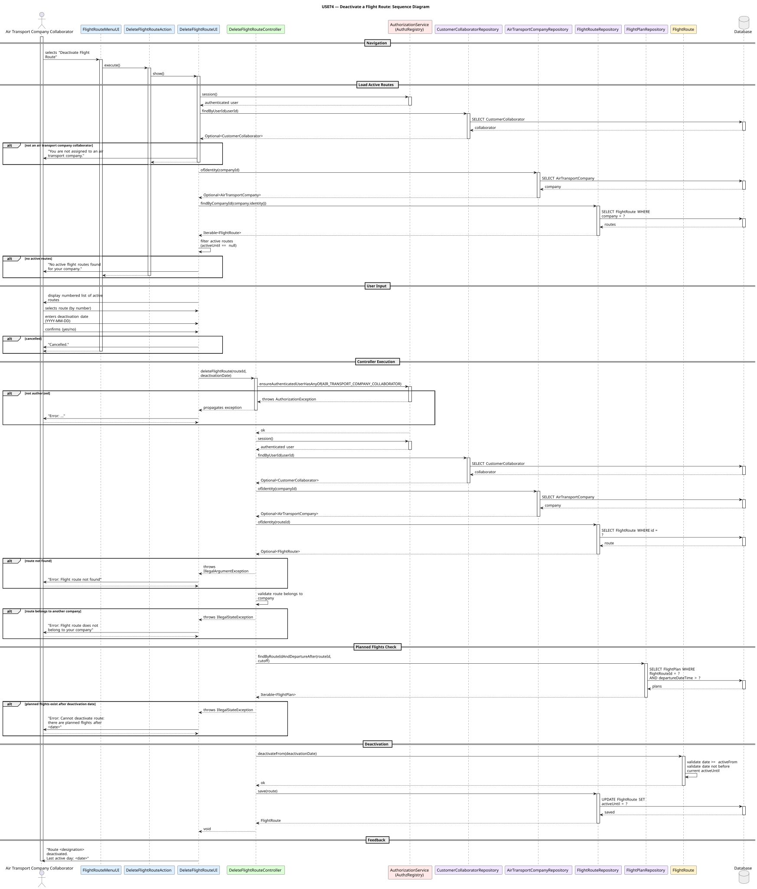

# US074 — Deactivate a Flight Route

## User Story

> As an **Air Transport Company Collaborator (ATCC)**, I want to deactivate a flight route from a given date onwards. No more flights can be created on a deleted flight route. But a route cannot be deleted if there are planned flights after that date.

---

## Acceptance Criteria

| # | Criterion |
|---|-----------|
| AC01 | Only an authenticated **ATCC** can deactivate a flight route |
| AC02 | The route must belong to the logged-in collaborator's company |
| AC03 | The ATCC must select a deactivation date |
| AC04 | If there are flight plans on this route with departure after the deactivation date, the operation is rejected |
| AC05 | Deactivation is a soft delete — the route data is preserved in the system |
| AC06 | After deactivation, no new flights can be created on the route |
| AC07 | A deactivated route can be reactivated (clearing the deactivation date) |

---

## Implementation Overview

| Module | Role |
|--------|------|
| `aisafe.app.airtransport.console` | Console UI (`DeleteFlightRouteUI`, `FlightRouteMenuUI`) |
| `aisafe.app.javafx` | JavaFX UI (`FlightRoutesUI` — Deactivate/Reactivate buttons) |
| `aisafe.core` | Controller (`DeleteFlightRouteController`), domain (`FlightRoute`) |
| `aisafe.persistence.impl` | `JpaFlightRouteRepository`, `JpaFlightPlanRepository` |

---

## EAPLI Theoretical Principles — Practical Application

### Domain-Driven Design (DDD)

- `FlightRoute` encapsulates the deactivation logic in `deactivateFrom(date)` and `reactivate()`, maintaining its own invariants (e.g., cannot set deactivation date earlier than current one).
- The "no planned flights" constraint is enforced at the **application layer** because it requires cross-aggregate querying (`FlightPlanRepository`).
- `FlightPlan.flightRouteId` links plans to routes, enabling the constraint check without violating aggregate boundaries.

### Gang of Four (GoF) Patterns

| Pattern | Location | Purpose |
|---------|----------|---------|
| **Repository** | `FlightRouteRepository`, `FlightPlanRepository` | Query routes by company, query plans by route and date |
| **Template Method** | `AbstractUI.doShow()` | Consistent UI lifecycle across all console UIs |

### SOLID Principles

1. **Single Responsibility Principle (SRP)** — `FlightRoute` owns its deactivation state; `DeleteFlightRouteController` owns the business coordination.
2. **Open/Closed Principle (OCP)** — New deactivation rules (e.g., regulatory checks) can be added to the controller without changing the domain.
3. **Liskov Substitution Principle (LSP)** — Any `FlightRouteRepository` or `FlightPlanRepository` implementation is substitutable (JPA, InMemory).
4. **Interface Segregation Principle (ISP)** — `FlightPlanRepository.findByRouteIdAndDepartureAfter` is a focused, use-case-specific query.
5. **Dependency Inversion Principle (DIP)** — Controller depends on repository interfaces, enabling test stubs.

---

## Class Diagram

---

## Sequence Diagram — Deactivate Flight Route

---

## User Interaction Flow

### Console
1. ATCC enters **Flight Route Management → Deactivate Flight Route**.
2. System lists all **active** routes of the ATCC's company (numbered).
3. ATCC selects the route by number.
4. ATCC enters the deactivation date.
5. ATCC confirms with `yes`.
6. If no planned flights exist after that date, the route is deactivated and the last active day is shown.
7. If planned flights exist, an error is shown and the route remains active.

### JavaFX
1. ATCC navigates to **Flight Routes** — table shows company routes.
2. Active routes show a red **Deactivate** button; inactive routes show a green **Reactivate** button.
3. Clicking **Deactivate** opens a `TextInputDialog` for the date, followed by a confirmation `Alert`.
4. On success, the table refreshes and the status column updates.
5. Clicking **Reactivate** opens a confirmation `Alert` and restores the route to active.

---

## Key Classes

| Class | Location | Responsibility |
|-------|----------|----------------|
| `DeleteFlightRouteUI` | `airtransport.presentation.flightroute` | Console: list routes, date input, confirmation |
| `FlightRoutesUI` | `javafxui.presentation.flightroute` | JavaFX: Deactivate/Reactivate buttons per row |
| `DeleteFlightRouteController` | `flightRoute.application` | Authorization, ownership check, flight plan check, deactivation |
| `FlightRoute` | `flightRoute.domain` | `deactivateFrom(date)`, `reactivate()`, `isActive()` |
| `FlightRouteRepository` | `flightRoute.repository` | `findByCompanyId`, `save` |
| `FlightPlanRepository` | `flightPlan.repository` | `findByRouteIdAndDepartureAfter` |

---

## Domain Notes

- `activeUntil = null` means the route is permanently active.
- `activeUntil = date` means the route is active up to and including that date (last active day semantics).
- `deactivateFrom(date)` rejects a date earlier than the current `activeUntil` (cannot move the deactivation earlier).
- `reactivate()` clears `activeUntil` back to null, making the route active again.
- The planned flights constraint relies on `FlightPlan.flightRouteId` being set when flight plans are created for a route (established in US080).
