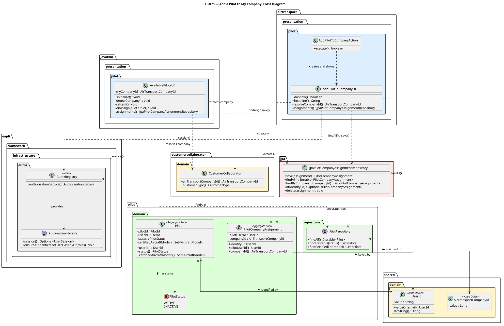
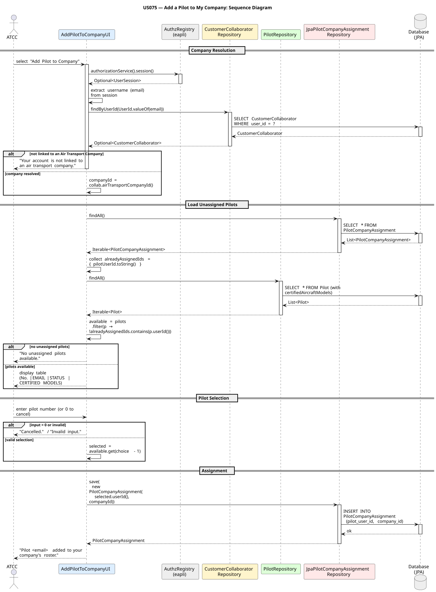

# US075 — Add a Pilot to My Company

## User Story

> As an **Air Transport Company Collaborator**, I want to add a pilot to my company.
> A pilot is a system's user. A pilot is certified to pilot one or more aircraft models.

---

## Acceptance Criteria

| # | Criteria |
|---|-----------|
| AC01 | Only an authenticated Air Transport Company Collaborator can perform this operation. |
| AC02 | The system presents only pilots that are not yet assigned to any company. |
| AC03 | A pilot must be a registered system user with at least one certified aircraft model. |
| AC04 | The assignment is persisted as a `PilotCompanyAssignment` record linked to the collaborator's company. |
| AC05 | A pilot can only belong to one company at a time — duplicate assignments are prevented. |
| AC06 | The operation is cancelled gracefully if no unassigned pilots are available. |

---

## Implementation Overview

| Module | Role |
|--------|------|
| `aisafe.app.airtransport.console` | Console UI (`AddPilotToCompanyUI`) and menu action wiring (`AddPilotToCompanyAction`) |
| `aisafe.app.javafx` | JavaFX UI (`AvailablePilotsUI`) — table view with inline "Assign to My Company" action |
| `aisafe.core` | Domain aggregates `Pilot`, `PilotCompanyAssignment`; repository interface `PilotRepository` |
| `aisafe.persistence.impl` | `JpaPilotCompanyAssignmentRepository` — JPA persistence for roster assignments |

---

## Class Diagram



---

## Sequence Diagram — Add Pilot to Company (Console)



---

## Flow Description

### Company Resolution

Before presenting pilots, both UIs resolve the collaborator's company:

1. The active session username (email) is read from `AuthzRegistry.authorizationService().session()`.
2. `CustomerCollaboratorRepository.findByUserId(UserId)` returns the `CustomerCollaborator` for that email.
3. `collab.airTransportCompanyId()` provides the `AirTransportCompanyId` used in subsequent queries.
4. If the account is not linked to a company (or is not of type `AIR_TRANSPORT_COMPANY`), the operation is aborted with a message.

### Filtering Available Pilots

```
allPilots = PilotRepository.findAll()
assignedIds = PilotCompanyAssignmentRepository.findAll()
               → collect pilotUserId strings into a Set

available = allPilots
            .filter(p → !assignedIds.contains(p.userId()))
```

Pilots already assigned to any company (not just the current one) are excluded — enforcing AC05.

### Assignment

A new `PilotCompanyAssignment(pilotUserId, companyId)` is instantiated and persisted via `JpaPilotCompanyAssignmentRepository.save(...)`. No changes are made to the `Pilot` aggregate itself.

---

## Key Classes

| Class | Location | Responsibility |
|-------|----------|----------------|
| `AddPilotToCompanyUI` | `airtransport.presentation.pilot` | Console UI: lists available pilots and prompts for selection |
| `AddPilotToCompanyAction` | `airtransport.presentation.pilot` | Menu action that instantiates and shows `AddPilotToCompanyUI` |
| `AvailablePilotsUI` | `javafxui.presentation.pilot` | JavaFX table of unassigned pilots with inline assign button |
| `Pilot` | `pilot.domain` | Aggregate Root — holds `userId`, `status`, `certifiedAircraftModels` |
| `PilotStatus` | `pilot.domain` | Enumeration: `ACTIVE`, `INACTIVE` |
| `PilotCompanyAssignment` | `pilot.domain` | Aggregate Root — maps `pilotUserId` to `companyId`; keyed by `UserId` |
| `PilotRepository` | `pilot.repository` | Repository interface for `Pilot` aggregate |
| `JpaPilotCompanyAssignmentRepository` | `jpa` | JPA repository for `PilotCompanyAssignment`; supports `findByCompanyId` |
| `CustomerCollaborator` | `customercollaborator.domain` | Provides the company link for the logged-in collaborator |
| `UserId` | `shared.domain` | Value Object — cross-aggregate identity token for system users |
| `AirTransportCompanyId` | `shared.domain` | Value Object — cross-aggregate identity token for companies |

---

## EAPLI Theoretical Principles — Practical Application

### Domain-Driven Design (DDD)

- **Ubiquitous Language**: "Pilot," "Roster," "Assignment," "Certified Aircraft Model" form the vocabulary of the Crew Roster Management subdomain.
- **Bounded Context**: Pilot roster management is a subdomain of Aviation Operations, separate from Identity & Access Management. The `Pilot` aggregate and `PilotCompanyAssignment` aggregate each have their own transactional boundaries.
- **Aggregate Root**: `PilotCompanyAssignment` is a dedicated Aggregate Root keyed by `UserId`. This models the roster entry as a first-class domain object with its own lifecycle — it can be created and deleted without touching either the `Pilot` or the `AirTransportCompany` aggregate.
- **Reference-by-Identity**: The assignment stores only `pilotUserId` and `companyId` as Value Objects — no direct object references cross the aggregate boundary, avoiding coupling.
- **Repository Pattern**: `PilotRepository` and `JpaPilotCompanyAssignmentRepository` each serve exactly one aggregate root, following the one-repository-per-aggregate rule.

### Gang of Four Design Patterns

| Pattern | Application | Benefit |
|---------|------------|---------|
| **Repository** | `PilotRepository` and `JpaPilotCompanyAssignmentRepository` abstract JPA persistence | Domain layer remains independent of persistence technology |
| **Factory Method** | `PilotCompanyAssignment` constructor enforces `Preconditions.noneNull` at creation | Invariants satisfied from the moment of instantiation |
| **Strategy** | `CONSTRAINED_RESIZE_POLICY_FLEX_LAST_COLUMN` in JavaFX table — column sizing strategy is pluggable | UI layout adaptable without changing domain logic |

### SOLID Principles

- **Single Responsibility Principle (SRP)**: `AddPilotToCompanyUI` handles only presentation; `PilotCompanyAssignment` handles only roster membership state; `JpaPilotCompanyAssignmentRepository` handles only persistence.
- **Open/Closed Principle (OCP)**: The filtering logic (exclude already-assigned pilots) is expressed declaratively via stream predicates — new filter criteria can be added without modifying the UI class.
- **Interface Segregation Principle (ISP)**: `PilotRepository` exposes only pilot-specific query methods (`findByStatus`, `findCertifiedFor`, `findAll`) rather than a generic data-access API.
- **Dependency Inversion Principle (DIP)**: Both UI classes depend on `PilotRepository` (interface) rather than any concrete JPA implementation.

### Data Transfer Objects (DTOs)

No dedicated DTO is used in this flow — pilots are displayed directly via their domain accessors (`userId()`, `status()`, `certifiedAircraftModels()`). This is acceptable for a read-only listing within the same bounded context.
