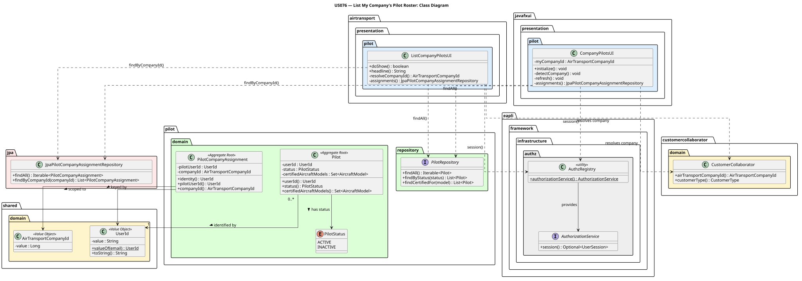
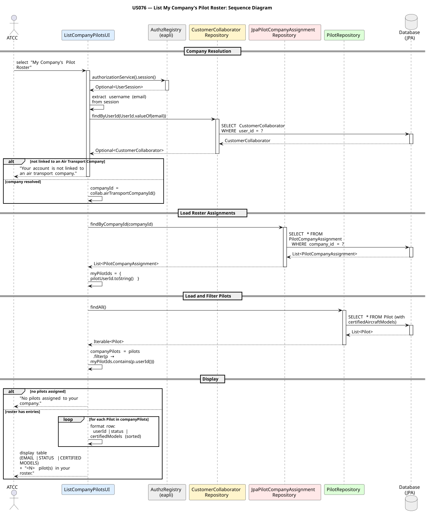

# US076 — List My Company's Pilot Roster

## User Story

> As an **Air Transport Company Collaborator**, I want to list my company's pilot roster.

---

## Acceptance Criteria

| # | Criteria |
|---|-----------|
| AC01 | Only an authenticated Air Transport Company Collaborator can perform this operation. |
| AC02 | The roster shows only pilots assigned to the collaborator's own company. |
| AC03 | Each entry displays the pilot's email (system identity), status, and certified aircraft models. |
| AC04 | If no pilots are assigned to the company, a clear informational message is shown. |
| AC05 | The list reflects the current state of the database at the time of the request. |

---

## Implementation Overview

| Module | Role |
|--------|------|
| `aisafe.app.airtransport.console` | Console UI (`ListCompanyPilotsUI`) — tabular read-only display |
| `aisafe.app.javafx` | JavaFX UI (`CompanyPilotsUI`) — table view with live status and action columns |
| `aisafe.core` | Domain aggregates `Pilot`, `PilotCompanyAssignment`; repository interface `PilotRepository` |
| `aisafe.persistence.impl` | `JpaPilotCompanyAssignmentRepository` — `findByCompanyId` query to scope results to the caller's company |

---

## Class Diagram



---

## Sequence Diagram — List Pilot Roster (Console)



---

## Flow Description

### Company Resolution

The same pattern as US075 applies:

1. The active session username (email) is read from `AuthzRegistry.authorizationService().session()`.
2. `CustomerCollaboratorRepository.findByUserId(UserId)` returns the `CustomerCollaborator` for that email.
3. `collab.airTransportCompanyId()` provides the `AirTransportCompanyId` used to scope the roster query.
4. If the account is not linked to an Air Transport Company, the operation is aborted.

### Building the Roster

```
myPilotIds = PilotCompanyAssignmentRepository
               .findByCompanyId(companyId)
               → collect pilotUserId strings into a Set

companyPilots = PilotRepository.findAll()
                 .filter(p → myPilotIds.contains(p.userId()))
```

`findByCompanyId` isolates assignments for the caller's company only — pilots assigned to other companies are never loaded into the result set. The cross-reference by `UserId` string ensures matching between the two aggregates without coupling them directly.

### Output

Each row shows:

| Column | Source |
|--------|--------|
| EMAIL | `pilot.userId().toString()` |
| STATUS | `pilot.status().name()` (`ACTIVE` / `INACTIVE`) |
| CERTIFIED MODELS | `pilot.certifiedAircraftModels()` sorted and joined |

---

## Key Classes

| Class | Location | Responsibility |
|-------|----------|----------------|
| `ListCompanyPilotsUI` | `airtransport.presentation.pilot` | Console UI: resolves company, loads and prints roster |
| `CompanyPilotsUI` | `javafxui.presentation.pilot` | JavaFX table displaying the roster with status and action columns |
| `Pilot` | `pilot.domain` | Aggregate Root — holds `userId`, `status`, `certifiedAircraftModels` |
| `PilotStatus` | `pilot.domain` | Enumeration: `ACTIVE`, `INACTIVE` |
| `PilotCompanyAssignment` | `pilot.domain` | Aggregate Root — maps `pilotUserId` to `companyId`; scopes the roster to a specific company |
| `PilotRepository` | `pilot.repository` | Repository interface for `Pilot` aggregate |
| `JpaPilotCompanyAssignmentRepository` | `jpa` | JPA repository; `findByCompanyId` returns only assignments for the given company |
| `CustomerCollaborator` | `customercollaborator.domain` | Provides the company link for the logged-in collaborator |
| `UserId` | `shared.domain` | Value Object — cross-aggregate identity token for system users |
| `AirTransportCompanyId` | `shared.domain` | Value Object — cross-aggregate identity token for companies |

---

## EAPLI Theoretical Principles — Practical Application

### Domain-Driven Design (DDD)

- **Ubiquitous Language**: "Pilot Roster," "Company Pilots," "Certified Aircraft Models" are the vocabulary of the Crew Roster Management subdomain.
- **Bounded Context**: The listing operation reads from two separate aggregates (`Pilot` and `PilotCompanyAssignment`) within the Aviation Operations context. Neither aggregate is mutated during this operation.
- **Reference-by-Identity**: `PilotCompanyAssignment` stores only `pilotUserId` (a `UserId` Value Object), not a direct reference to the `Pilot` aggregate root. The join is performed at the application layer by matching string representations, keeping the aggregates decoupled.
- **Repository Pattern**: `PilotRepository` and `JpaPilotCompanyAssignmentRepository` each serve exactly one aggregate root. The `findByCompanyId` method is a domain-meaningful query expressed in the ubiquitous language of the roster subdomain.

### Gang of Four Design Patterns

| Pattern | Application | Benefit |
|---------|------------|---------|
| **Repository** | `PilotRepository` and `JpaPilotCompanyAssignmentRepository` abstract JPA persistence | Domain layer is independent of the persistence technology |
| **Template Method** | `AbstractUI.show()` in eapli calls the overridable `doShow()` | UI classes implement only domain-specific logic; lifecycle management is inherited |

### SOLID Principles

- **Single Responsibility Principle (SRP)**: `ListCompanyPilotsUI` is responsible solely for reading and displaying the roster; mutation operations (activate, deactivate, remove) belong to separate UI classes (US077).
- **Open/Closed Principle (OCP)**: The filtering predicate (`myPilotIds.contains(...)`) can be extended with additional criteria without modifying the repository or domain layer.
- **Interface Segregation Principle (ISP)**: `PilotRepository` exposes only pilot-specific query methods; the assignment repository exposes only assignment-specific queries — no god-interface anti-pattern.
- **Dependency Inversion Principle (DIP)**: Both UI classes depend on the `PilotRepository` interface rather than any concrete JPA implementation.

### Query Scope and Data Integrity

The `findByCompanyId` query ensures that a collaborator can only ever observe pilots assigned to their own company. There is no application-layer filtering step that could be bypassed — the company scope is enforced at the database query level, consistent with the *fail-safe defaults* security principle.
