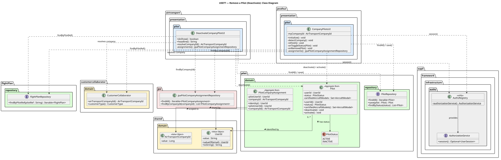
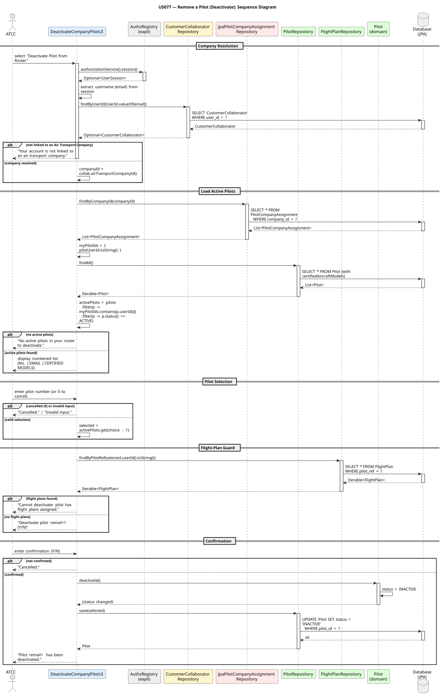

# US077 — Remove a Pilot (Deactivate)

## User Story

> As an **Air Transport Company Collaborator**, I want to make a pilot inactive in my company's roster.
> Cannot deactivate a pilot with flight plans assigned.

---

## Acceptance Criteria

| # | Criteria |
|---|-----------|
| AC01 | Only an authenticated Air Transport Company Collaborator can perform this operation. |
| AC02 | Only pilots assigned to the collaborator's own company are shown. |
| AC03 | Only **ACTIVE** pilots are presented as candidates for deactivation. |
| AC04 | A pilot with any flight plan assigned cannot be deactivated; a clear error is shown. |
| AC05 | The collaborator must confirm the action before the status change is persisted. |
| AC06 | On success, the pilot's status is set to `INACTIVE` and the change is immediately reflected. |

---

## Implementation Overview

| Module | Role |
|--------|------|
| `aisafe.app.airtransport.console` | Console UI (`DeactivateCompanyPilotUI`) — numbered list of active pilots, flight-plan guard, confirmation prompt |
| `aisafe.app.javafx` | JavaFX UI (`CompanyPilotsUI`) — "Deactivate" button in the action column of the pilot roster table |
| `aisafe.core` | Domain aggregate `Pilot`; `Pilot.deactivate()` enforces the status transition; `FlightPlanRepository.findByPilotRef()` enforces the business rule |
| `aisafe.persistence.impl` | `JpaPilotCompanyAssignmentRepository`, `JpaPilotRepository`, `JpaFlightPlanRepository` |

---

## Class Diagram



---

## Sequence Diagram — Deactivate Pilot (Console)



---

## Flow Description

### Company Resolution

Identical to US076:

1. The active session username (email) is read from `AuthzRegistry.authorizationService().session()`.
2. `CustomerCollaboratorRepository.findByUserId(UserId)` returns the `CustomerCollaborator` for that email.
3. `collab.airTransportCompanyId()` provides the `AirTransportCompanyId` used to scope all subsequent queries.
4. If the account is not linked to an Air Transport Company, the operation is aborted.

### Building the Candidate List

```
myPilotIds = PilotCompanyAssignmentRepository
               .findByCompanyId(companyId)
               → collect pilotUserId strings into a Set

activePilots = PilotRepository.findAll()
                 .filter(p → myPilotIds.contains(p.userId()))
                 .filter(p → p.status() == ACTIVE)
```

Only `ACTIVE` pilots are shown — pilots already `INACTIVE` are excluded from the selection list.

### Flight-Plan Guard

Before applying the status change, the system checks whether the selected pilot has any flight plan on record:

```
hasFlightPlans = FlightPlanRepository
                   .findByPilotRef(pilot.userId().toString())
                   .iterator().hasNext()
```

If the check returns `true`, the operation is rejected with a clear message and no mutation occurs.

### Status Transition

```
pilot.deactivate()   // throws IllegalStateException if already INACTIVE
PilotRepository.save(pilot)
```

`Pilot.deactivate()` is a domain method that enforces the `ACTIVE → INACTIVE` invariant. The aggregate is then persisted via the repository.

### Confirmation Step

The user must answer **Y** to a confirmation prompt before `deactivate()` is called. Any other input cancels the operation without side effects.

---

## Key Classes

| Class | Location | Responsibility |
|-------|----------|----------------|
| `DeactivateCompanyPilotUI` | `airtransport.presentation.pilot` | Console UI: resolves company, lists active pilots, guards against flight plans, prompts for confirmation, persists the status change |
| `CompanyPilotsUI` | `javafxui.presentation.pilot` | JavaFX roster table; "Deactivate" button column applies the same flight-plan guard and status transition |
| `Pilot` | `pilot.domain` | Aggregate Root — `deactivate()` transitions status from `ACTIVE` to `INACTIVE`; throws if already inactive |
| `PilotStatus` | `pilot.domain` | Enumeration: `ACTIVE`, `INACTIVE` |
| `PilotCompanyAssignment` | `pilot.domain` | Scopes the candidate list to the collaborator's company |
| `FlightPlanRepository` | `flightPlan.repository` | `findByPilotRef(String)` — guards the deactivation business rule |
| `PilotRepository` | `pilot.repository` | `findAll()` + `save(Pilot)` — loads candidates and persists the status change |
| `JpaPilotCompanyAssignmentRepository` | `jpa` | `findByCompanyId` returns only assignments for the given company |
| `CustomerCollaborator` | `customercollaborator.domain` | Provides the company link for the logged-in collaborator |
| `UserId` | `shared.domain` | Value Object — cross-aggregate identity token |
| `AirTransportCompanyId` | `shared.domain` | Value Object — scopes queries to the caller's company |

---

## EAPLI Theoretical Principles — Practical Application

### Domain-Driven Design (DDD)

- **Ubiquitous Language**: "Deactivate Pilot," "Inactive Roster," "Flight Plan Guard" are terms from the Crew Roster Management subdomain.
- **Bounded Context**: The deactivation operation spans two aggregates — `Pilot` (mutated) and `FlightPlan` (read-only guard) — while keeping them decoupled. `FlightPlanRepository.findByPilotRef` uses a plain `String` cross-reference, avoiding a direct dependency between the two aggregate roots.
- **Aggregate Invariant**: `Pilot.deactivate()` guards the `ACTIVE → INACTIVE` transition within the aggregate boundary. No UI or controller may set the `status` field directly — the mutation is fully encapsulated in the domain method.
- **Repository Pattern**: `PilotRepository`, `JpaPilotCompanyAssignmentRepository`, and `FlightPlanRepository` each serve exactly one aggregate root. The business-rule check is expressed through the domain-meaningful `findByPilotRef` query rather than an ad-hoc join.

### Gang of Four Design Patterns

| Pattern | Application | Benefit |
|---------|------------|---------|
| **Repository** | `PilotRepository` and `JpaFlightPlanRepository` abstract JPA persistence | Domain layer is independent of the persistence technology |
| **Template Method** | `AbstractUI.show()` in eapli calls the overridable `doShow()` | `DeactivateCompanyPilotUI` implements only domain-specific logic; lifecycle management is inherited |

### SOLID Principles

- **Single Responsibility Principle (SRP)**: `DeactivateCompanyPilotUI` is responsible solely for the deactivation flow; listing the roster belongs to `ListCompanyPilotsUI` (US076). The status transition logic is encapsulated in `Pilot.deactivate()`, not in the UI.
- **Open/Closed Principle (OCP)**: Adding a new guard condition (e.g., future regulatory check) requires only a new predicate — neither the repository nor `Pilot.deactivate()` need to change.
- **Interface Segregation Principle (ISP)**: `FlightPlanRepository` exposes only flight-plan queries; `PilotRepository` exposes only pilot queries — no god-interface anti-pattern.
- **Dependency Inversion Principle (DIP)**: Both UI classes depend on repository interfaces rather than concrete JPA implementations.

### Data Integrity and Security

The flight-plan guard is evaluated immediately before the status mutation and inside the same request scope. This prevents a time-of-check/time-of-use race where a flight plan could be assigned between the list render and the confirmation step, consistent with the *fail-safe defaults* security principle.
